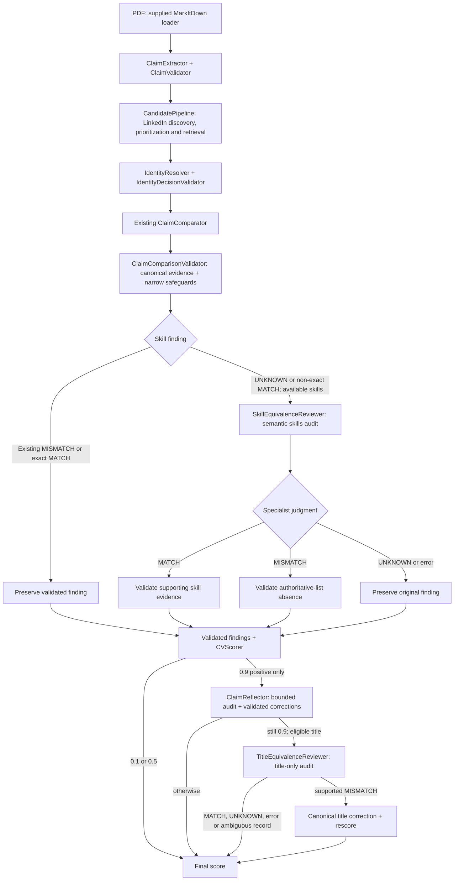

# FTEC5660 Homework 2: CV Verification Agent

Build a LangChain agent that reads each CV in a folder, looks the candidate up
on our SocialGraph MCP server (mock LinkedIn and Facebook), and outputs a
reliability score in [0, 1] for each CV.

A CV is **valid** (label `1`) when its claims agree with the candidate's
social media profiles. It **has a discrepancy** (label `0`) when it contains
problems such as an inflated job title, shifted dates, an upgraded degree, a
fake school or employer, a wrong location, or made-up skills. Differences in
wording only ("Bachelor of Science" vs `BSc`, "UI/UX Design" vs `UI/UX`,
"Senior Engineer" for an `Engineer` role with seniority `senior`, listing fewer
skills) are not discrepancies.

## Student task

Fill in the two functions in `hw2.py` that contain `### YOUR CODE HERE`. You
may add imports, constants and helper functions above them, but do not change
the provided code below them:

- `build_agent(tools)` creates your agent from the MCP tools.
- `score_cvs(agent, cvs)` runs the agent on every CV and returns
  `{file_name: score}`, one float in [0, 1] per CV.

A score above `0.5` means "valid"; `0.5` or below means "has discrepancy". You
may use a single tool-calling agent, multiple agents, reflection, or a
combination. Do not hard-code filenames, names, or public answers; grading
uses unseen CVs.

## MCP server

The server is hosted at `https://ftec5660.ngrok.app/mcp`. `hw2.py` already
connects to it and passes you these tools:

| Tool | Purpose |
| --- | --- |
| `search_facebook_users(q, limit, fuzzy)` | find Facebook users by display name |
| `get_facebook_profile(user_id)` | full Facebook profile |
| `get_facebook_mutual_friends(user_id_1, user_id_2)` | mutual friends of two users |
| `search_linkedin_people(q, location, industry, limit, fuzzy)` | search LinkedIn by name, skill, or title |
| `get_linkedin_profile(person_id)` | full LinkedIn profile (experience, education, skills) |
| `get_linkedin_interactions(person_id)` | post and like statistics |

Print `tool.name`, `tool.description`, and `tool.args` for the full schemas.

## Setup and public test

```bash
python3 -m venv .venv
source .venv/bin/activate
pip install -r requirements.txt
echo "DEEPSEEK_API_KEY=your_key_here" > .env
python3 hw2.py --cv-folder public_test
```

Use your own DeepSeek API key (from https://platform.deepseek.com).

The program creates `results.csv` in the current directory. Its columns are
`cv`, `score`, and `correctness`. The public labels are in
`public_test/ground_truth.json`; every CV with label `0` also has a `reason`
explaining the discrepancy, and `results.csv` shows it when your agent misses
one. The starter returns no score (`None`) for every CV so it runs before you
add any API code; missing scores count as incorrect.

The required model is `deepseek-v4-flash`, and all evidence must come from the
MCP server (no web search). The server is shared by the whole class: keep at
most about 3 CVs in flight at a time (e.g. `asyncio.Semaphore(3)`). We grade
with our own API key, so never put a key in your code; `.env` must stay out of
git.


## Task 2: Fool the Verifier

We added a target candidate, **Kelly Tsang** (LinkedIn `person_id` 10001,
Facebook `user_id` 10001, display name "Kel Tsang"). Her true CV is
`task2/target_cv.pdf`.

Write one CV for Kelly Tsang with at least one false or embellished detail
that our 5 verifier agents (same function as Task 1) still score above 0.5.
Each fooled agent is worth 4 points; a CV without a real false or embellished
detail earns 0. Attack your own Task 1 agent first:

```bash
cp my_attack.pdf task2/adversarial_cv.pdf
python3 hw2.py --cv-folder task2
```

`results.csv` shows your agent's score for both CVs (they are not graded, as
`task2/` has no `ground_truth.json`). Only the PDF is the attack surface; do not
attack the MCP server. See the homework description for the full rules.

## Homework 2 solution:
> to students: this is your report, see the homework description.

### Task 1



I built a modular LangChain CV verifier using `deepseek-v4-flash` and SocialGraph LinkedIn evidence. The implementation follows these steps:

- **Extract and validate:** Convert PDF text into structured CV claims, with bounded retry for invalid extraction.
- **Discover and order candidate profiles:** Search LinkedIn by name with available current/unspecified city hints, always include name-only search, and supplement saturated results with an industry-filtered search when supported. An LLM prioritizes up to five promising candidates from the CV and search metadata; a deterministic fallback then orders remaining candidates by industry relevance and location, preserving stable ties. Investigate in this order, retrieving up to two profiles per batch and eight in total. Disagreeing CV details are not grounds for excluding a candidate.
- **Resolve identity before checking truthfulness:** Use corroborating career and education evidence to identify the person, so a false CV claim does not automatically disqualify the correct profile.
- **Compare and validate claims:** Align employment and education by context, not array position; check dates, titles, location, qualifications and skills. Python reconstructs citations from original profile evidence and validates findings.
- **Audit uncertain semantics:** A bounded skill reviewer checks non-exact or UNKNOWN skill claims for genuine aliases versus absence from the authoritative skills list. Positive results receive reflection and, when correspondence is unambiguous, a specialized title-equivalence audit. Invalid optional judgments preserve the baseline.
- **Score and evaluate:** Assign **0.9** for fully supported claims, **0.1** for grounded discrepancies and **0.5** for unresolved evidence. I tested 25 structured controls and alternatives including a hybrid deterministic aligner, which I rejected after observing correspondence and grounding weaknesses. An earlier public campaign achieved **70/70** classifications; the final skill-specialist campaign achieved **69/70**, with all 30 negative outcomes grounded and one unrelated end-year UNKNOWN resulting in 0.5. These are public-test results, not guarantees on unseen CVs.


### Task 2

**Chosen attacks.** The submitted CV uses two channels on two facts. The AIA title is a raster `Director` painted over the covered word Manager, so the page shows Director and `cv_text` still contains Manager. The HSBC start year is a ToUnicode split on those four digits: the page shows 2014 and the loader returns 2016.

**Why I expect them to work.** The five graders read the PDF with the same loader as `hw2.py`, and neither false fact is in the text they score. A reader of the page can still check both against LinkedIn person 10001. The channels also fail differently. An OCR pass can read the picture and still miss the year, and copying the year can yield 2016 while Director remains a picture.

**Methodology.** I started from the assignment constraints: the graders use `deepseek-v4-flash` and the SocialGraph server, award points only for a score above 0.5, and a human must still be able to see a real false detail. I retrieved Kelly Tsang's record (AIA Manager, mid, from 2022; HSBC Analyst, 2016–2019) and probed the loader directly. Raster text and a FreeText appearance are painted on the page and absent from `cv_text`, because plugins are off and nothing OCRs the image. White text, rendering mode 3, clipping, and a hidden optional-content group do the opposite: the reader misses them and the model receives them. Homoglyphs and zero-width characters stay in the extracted string. A ToUnicode map can make the glyphs and the extracted characters disagree. On my own verifier the truthful CV scored 0.9. An ordinary-text AIA title of Director was extracted and scored 0.1 once comparison treated Director as distinct from Manager. The same title drawn only as a raster line scored 0.9, with the extracted title still Manager. A ToUnicode split, page showing Director and `cv_text` returning Manager, also scored 0.9, so I reused that split on the HSBC year. An instruction telling the extractor to emit Manager did not change the extracted title, and when I hid that instruction in white text beside the two loader tricks the folder run fell to 0.5, which does not pass. I removed it.

###  Reflection on the Paradoxes of Artificial Intelligence
Artificial intelligence presents several paradoxes that challenge conventional assumptions about technology and human work. Moravec's paradox suggests that tasks requiring considerable human intellectual effort can be relatively easy for AI, while seemingly simple human abilities
remain difficult to replicate. Polanyi's paradox concerns the difficulty of explicitly defining knowledge that humans apply intuitively. The automation paradox describes how increased automation can make human oversight more important rather than less. The productivity paradox questions why improvements in technological capabilities do not always translate into proportional productivity gains. Finally, Jevons paradox suggests that making a resource more efficient or affordable can increase its overall consumption. These paradoxes became particularly relevant to me through developing an AI-based CV verification system for FTEC5660 and using coding agents throughout the development process.

Polanyi's paradox was particularly apparent in the CV verification task. My verifier needed to distinguish genuine qualifications from embellished claims while recognizing legitimate differences in wording. I initially assumed that objective checks and deterministic rules would provide the strongest foundation. However, I discovered that apparently straightforward judgments, such as whether "Director" and "Manager" represent equivalent positions, were difficult to formalize reliably. A rigid hierarchy of job titles would overlook organizational differences, while relying entirely on an LLM introduced inconsistent semantic judgments. I eventually adopted a hybrid of semantic reasoning and deterministic validation, introducing specialized reviewers for job titles and skills while retaining strict evidence requirements in Python. This experience demonstrated that reliable AI systems need to combine flexible judgment with explicit safeguards. The automation paradox was equally relevant to my use of coding agents. AI dramatically reduced the time required to write, refactor and implement software. Yet as implementation became easier, my responsibilities shifted toward specifying requirements, reviewing architecture, designing evaluations and investigating failures. I became less involved in writing every line of code but more responsible for determining whether the resulting system was trustworthy. For example, repeated evaluations sometimes produced different classifications despite unchanged code. Distinguishing stochastic model variation from genuine regressions required careful experimental controls and engineering judgment. Greater automation did not eliminate human responsibility; it changed where that responsibility was concentrated. This also exposed the productivity paradox and Jevons paradox. Coding agents made experimentation inexpensive enough that I could investigate multiple architectures, including deterministic verification, semantic comparison, reflection and specialist reviewers. Yet each additional experiment introduced evaluation, integration and maintenance costs. The ability to produce more code did not necessarily mean I could deliver a reliable solution proportionally faster. In fact, greater implementation capacity encouraged me to explore more possibilities than I otherwise would have. I learned that productivity depends not only on development speed but also on disciplined scope management, meaningful evaluation and knowing when to stop experimenting.

Overall, these paradoxes reshaped my understanding of AI-assisted engineering. The greatest benefit of AI was not simply that it wrote code faster, but that it allowed me to explore architectural hypotheses and learn from evidence at a much faster pace. At the same time, it reinforced the importance of human judgment, particularly in defining correctness and evaluating uncertainty. My central takeaway is that AI amplifies engineering capability, but does not replace engineering responsibility. The challenge is to use that increased capability deliberately, rather than allowing the ease of automation to create unnecessary complexity.

