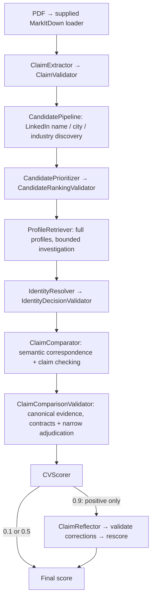

# FTEC5660 Homework 2: CV Verification Agent

Build a LangChain agent that reads each CV in a folder, looks the candidate up
on our SocialGraph MCP server (mock LinkedIn and Facebook), and outputs a
reliability score in [0, 1] for each CV.

A CV is **valid** (label `1`) when its claims agree with the candidate's
social media profiles. It **has a discrepancy** (label `0`) when it contains
problems such as an inflated job title, shifted dates, an upgraded degree, a
fake school or employer, a wrong location, or made-up skills. Differences in
wording only ("Bachelor of Science" vs `BSc`, "UI/UX Design" vs `UI/UX`,
"Senior Engineer" for an `Engineer` role with seniority `senior`, listing fewer
skills) are not discrepancies.

## Student task

Fill in the two functions in `hw2.py` that contain `### YOUR CODE HERE`. You
may add imports, constants and helper functions above them, but do not change
the provided code below them:

- `build_agent(tools)` creates your agent from the MCP tools.
- `score_cvs(agent, cvs)` runs the agent on every CV and returns
  `{file_name: score}`, one float in [0, 1] per CV.

A score above `0.5` means "valid"; `0.5` or below means "has discrepancy". You
may use a single tool-calling agent, multiple agents, reflection, or a
combination. Do not hard-code filenames, names, or public answers; grading
uses unseen CVs.

## MCP server

The server is hosted at `https://ftec5660.ngrok.app/mcp`. `hw2.py` already
connects to it and passes you these tools:

| Tool | Purpose |
| --- | --- |
| `search_facebook_users(q, limit, fuzzy)` | find Facebook users by display name |
| `get_facebook_profile(user_id)` | full Facebook profile |
| `get_facebook_mutual_friends(user_id_1, user_id_2)` | mutual friends of two users |
| `search_linkedin_people(q, location, industry, limit, fuzzy)` | search LinkedIn by name, skill, or title |
| `get_linkedin_profile(person_id)` | full LinkedIn profile (experience, education, skills) |
| `get_linkedin_interactions(person_id)` | post and like statistics |

Print `tool.name`, `tool.description`, and `tool.args` for the full schemas.

## Setup and public test

```bash
python3 -m venv .venv
source .venv/bin/activate
pip install -r requirements.txt
echo "DEEPSEEK_API_KEY=your_key_here" > .env
python3 hw2.py --cv-folder public_test
```

Use your own DeepSeek API key (from https://platform.deepseek.com).

The program creates `results.csv` in the current directory. Its columns are
`cv`, `score`, and `correctness`. The public labels are in
`public_test/ground_truth.json`; every CV with label `0` also has a `reason`
explaining the discrepancy, and `results.csv` shows it when your agent misses
one. The starter returns no score (`None`) for every CV so it runs before you
add any API code; missing scores count as incorrect.

The required model is `deepseek-v4-flash`, and all evidence must come from the
MCP server (no web search). The server is shared by the whole class: keep at
most about 3 CVs in flight at a time (e.g. `asyncio.Semaphore(3)`). We grade
with our own API key, so never put a key in your code; `.env` must stay out of
git.


## Task 2: Fool the Verifier

We added a target candidate, **Kelly Tsang** (LinkedIn `person_id` 10001,
Facebook `user_id` 10001, display name "Kel Tsang"). Her true CV is
`task2/target_cv.pdf`.

Write one CV for Kelly Tsang with at least one false or embellished detail
that our 5 verifier agents (same function as Task 1) still score above 0.5.
Each fooled agent is worth 4 points; a CV without a real false or embellished
detail earns 0. Attack your own Task 1 agent first:

```bash
cp my_attack.pdf task2/adversarial_cv.pdf
python3 hw2.py --cv-folder task2
```

`results.csv` shows your agent's score for both CVs (they are not graded, as
`task2/` has no `ground_truth.json`). Only the PDF is the attack surface; do not
attack the MCP server. See the homework description for the full rules.

## Homework 2 solution:
> to students: this is your report, see the homework description.

### Task 1



**Design and implementation.** I implemented a modular LangChain verifier using `deepseek-v4-flash` with thinking disabled and SocialGraph LinkedIn evidence. I separated claim extraction, candidate investigation, factual comparison, validation and scoring into individually testable responsibilities. The candidate pipeline searches by name and location, supplements saturated search results with industry hints, ranks investigation priority and retrieves full profiles under an eight-attempt budget. It then resolves identity *before* judging whether the CV is truthful: an incorrect CV detail must not automatically eliminate the correct person. The comparator jointly matches employment and education records by context rather than list position, then assesses name, location, employment, education and skills claims. I deliberately let DeepSeek propose semantic judgments while Python reconstructs original values, validates every claim and non-null evidence citation, and controls the final score. A supported mismatch scores **0.1**, fully supported claims **0.9**, and unresolved evidence or failure **0.5**. I added one bounded reflection pass for preliminary positive results to catch discrepancies the first comparison missed. I retained the lecturer's runner, with three concurrent CVs, per-CV timeouts and checkpointed output.

**How I evaluated alternatives.** Initially, I could achieve 7/7 on the public PDFs, but noticed that a correct final classification could conceal an unresolved comparison or an incorrect record match. I therefore created **25 independently labelled structured controls**: 23 with known binary labels and two genuine uncertainty cases, covering fabricated employers, schools and skills, modified dates and grades, aliases and reordered records. I kept labels outside model prompts and compared claim-level findings and evidence, not just scores.

I explored an explicit hybrid pipeline—`RecordAligner → DeterministicClaimVerifier → UNKNOWN-only SemanticClaimResolver`—because dates and other objective fields seemed suitable for deterministic checking. An early shadow experiment exposed six disagreements across 128 claims, particularly legitimate MBA and skill aliases; targeted semantic resolution later brought the hybrid to 7/7 on the public set. But my next question was whether making correspondence an authoritative intermediate decision created a new failure mode. In controlled alignment-injection tests, confidently wrong record mappings could propagate into immutable incorrect judgments. I also tested broader evidence alignment, correspondence plausibility checks and a one-call joint comparator. The broader approaches increased complexity or produced regressions rather than a clear accuracy benefit. A production-integrated hybrid later scored **23/23 binary cases** but only **31/35 targeted claims**, versus **34/35** for the incumbent comparator in that paired test; a separate contemporaneous comparison found **442/446 grounded claims** for production versus **413/446** for hybrid, with two hybrid alignment-contract failures. Hybrid used fewer tokens and was faster, and both reached 21/21 in contemporaneous public end-to-end runs, so I did not claim it was universally worse. I chose to retain the **joint semantic comparator, strict Python validation and positive-only reflection** because their evidence quality and failure containment were stronger, without an extra alignment stage. I also investigated Facebook corroboration, but its limited historical employment detail and inconsistent discovery did not justify another production dependency.

**What changed for robustness.** Repeated *complete* PDF runs changed my priorities. Even with unchanged code, one three-run campaign scored **6/7, 7/7, 6/7**. Unlike my fixed-profile controls, these runs exposed failures in extraction and identity selection: an invalid shortlist could exhaust the investigation budget, and a plausible same-name candidate could be selected despite conflicting career evidence. Other failures came from malformed city extraction, citations to null profile values, and a missed explicit **Senior Analyst** versus **Analyst/junior** contradiction. I addressed these mechanisms rather than replacing the verifier: deterministic fallback ordering of returned candidate metadata; stronger corroboration before accepting a proposed identity; one validator-guided extraction/comparison retry; an explicit list of permitted non-null evidence paths; preservation of independently validated mismatches when neighboring model output is malformed; and narrow Python adjudication of explicit seniority conflicts only when employer, base role and dates uniquely corroborate the corresponding record. I kept evidence validation strict and all recovery bounded.

**Results and limitations.** After those adjustments, I froze the implementation and ran the lecturer's literal `python3 hw2.py --cv-folder public_test` command **10 consecutive times: 70/70 correct classifications**, with all 30 negative decisions supported by grounded 0.1 findings rather than accidental 0.5 fallbacks. An independent clean-checkout integration campaign repeated **10/10 runs (70/70)**; the final grader-environment structured run also achieved **23/23 known labels, 35/35 targets and 446/446 grounded claims**. Earlier same-code structured batches still showed occasional semantic errors, so I regard these results as evidence of improved repeatability on the supplied workload, **not proof of perfect performance on unseen CVs**. My main lesson was that contract validation, identity evidence and explicit recovery policies mattered at least as much as the comparator's raw reasoning accuracy.

### Task 2

I started from the assignment constraints: the five graders read the PDF with the same loader as `hw2.py`, use `deepseek-v4-flash` and the SocialGraph server, and award points only for a score above 0.5, while a human must still be able to see a real false detail. I retrieved Kelly Tsang's record (LinkedIn person 10001: AIA Manager, mid, from 2022; HSBC Analyst, 2016–2019) and probed the loader directly. Raster text and a FreeText appearance are painted on the page and absent from `cv_text`, because plugins are off and nothing OCRs the image. White text, rendering mode 3, clipping, and a hidden optional-content group do the opposite: the reader misses them and the model receives them. Homoglyphs and zero-width characters stay in the extracted string. A ToUnicode map can make the glyphs and the extracted characters disagree. On my own verifier I then tested those hypotheses. The truthful CV scored 0.9. An ordinary-text AIA title of Director was extracted and scored 0.1 once comparison treated Director as distinct from Manager. The same title drawn only as a raster line scored 0.9, with the extracted title still Manager. A ToUnicode split, page showing Director and `cv_text` returning Manager, also scored 0.9, so I reused that split on the four digits of the HSBC start year, where the page shows 2014 and the loader returns 2016. An instruction telling the extractor to emit Manager did not change the extracted title, and when I hid that instruction in white text beside the two loader tricks the folder run fell to 0.5, which does not pass. I removed it. The submitted CV therefore uses two channels on two facts: a raster `Director` over the covered word Manager, and a ToUnicode HSBC start of 2014. I expect both to reach all five graders because they share this loader and neither false fact is in the text they score, while a reader of the page can still check both against person 10001. They also fail differently: an OCR pass can read the picture and still miss the year, and copying the year can yield 2016 while Director remains a picture.
