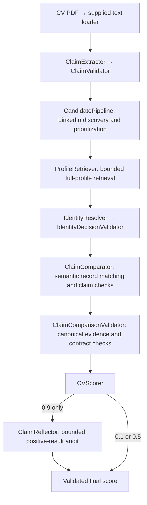

# FTEC5660 Homework 2: CV Verification Agent

Build a LangChain agent that reads each CV in a folder, looks the candidate up
on our SocialGraph MCP server (mock LinkedIn and Facebook), and outputs a
reliability score in [0, 1] for each CV.

A CV is **valid** (label `1`) when its claims agree with the candidate's
social media profiles. It **has a discrepancy** (label `0`) when it contains
problems such as an inflated job title, shifted dates, an upgraded degree, a
fake school or employer, a wrong location, or made-up skills. Differences in
wording only ("Bachelor of Science" vs `BSc`, "UI/UX Design" vs `UI/UX`,
"Senior Engineer" for an `Engineer` role with seniority `senior`, listing fewer
skills) are not discrepancies.

## Student task

Fill in the two functions in `hw2.py` that contain `### YOUR CODE HERE`. You
may add imports, constants and helper functions above them, but do not change
the provided code below them:

- `build_agent(tools)` creates your agent from the MCP tools.
- `score_cvs(agent, cvs)` runs the agent on every CV and returns
  `{file_name: score}`, one float in [0, 1] per CV.

A score above `0.5` means "valid"; `0.5` or below means "has discrepancy". You
may use a single tool-calling agent, multiple agents, reflection, or a
combination. Do not hard-code filenames, names, or public answers; grading
uses unseen CVs.

## MCP server

The server is hosted at `https://ftec5660.ngrok.app/mcp`. `hw2.py` already
connects to it and passes you these tools:

| Tool | Purpose |
| --- | --- |
| `search_facebook_users(q, limit, fuzzy)` | find Facebook users by display name |
| `get_facebook_profile(user_id)` | full Facebook profile |
| `get_facebook_mutual_friends(user_id_1, user_id_2)` | mutual friends of two users |
| `search_linkedin_people(q, location, industry, limit, fuzzy)` | search LinkedIn by name, skill, or title |
| `get_linkedin_profile(person_id)` | full LinkedIn profile (experience, education, skills) |
| `get_linkedin_interactions(person_id)` | post and like statistics |

Print `tool.name`, `tool.description`, and `tool.args` for the full schemas.

## Setup and public test

```bash
python3 -m venv .venv
source .venv/bin/activate
pip install -r requirements.txt
echo "DEEPSEEK_API_KEY=your_key_here" > .env
python3 hw2.py --cv-folder public_test
```

Use your own DeepSeek API key (from https://platform.deepseek.com).

The program creates `results.csv` in the current directory. Its columns are
`cv`, `score`, and `correctness`. The public labels are in
`public_test/ground_truth.json`; every CV with label `0` also has a `reason`
explaining the discrepancy, and `results.csv` shows it when your agent misses
one. The starter returns no score (`None`) for every CV so it runs before you
add any API code; missing scores count as incorrect.

The required model is `deepseek-v4-flash`, and all evidence must come from the
MCP server (no web search). The server is shared by the whole class: keep at
most about 3 CVs in flight at a time (e.g. `asyncio.Semaphore(3)`). We grade
with our own API key, so never put a key in your code; `.env` must stay out of
git.


## Task 2: Fool the Verifier

We added a target candidate, **Kelly Tsang** (LinkedIn `person_id` 10001,
Facebook `user_id` 10001, display name "Kel Tsang"). Her true CV is
`task2/target_cv.pdf`.

Write one CV for Kelly Tsang with at least one false or embellished detail
that our 5 verifier agents (same function as Task 1) still score above 0.5.
Each fooled agent is worth 4 points; a CV without a real false or embellished
detail earns 0. Attack your own Task 1 agent first:

```bash
cp my_attack.pdf task2/adversarial_cv.pdf
python3 hw2.py --cv-folder task2
```

`results.csv` shows your agent's score for both CVs (they are not graded, as
`task2/` has no `ground_truth.json`). Only the PDF is the attack surface; do not
attack the MCP server. See the homework description for the full rules.

## Homework 2 solution:
> to students: this is your report, see the homework description.

### Task 1



**Approach.** We implemented a modular LangChain pipeline using `deepseek-v4-flash` (thinking disabled) and SocialGraph LinkedIn evidence. The extractor catalogs named, location, employment, education and skill claims; the candidate pipeline searches by name/location, prioritizes and retrieves full profiles, then validates the proposed identity. The comparator jointly aligns employment/education records semantically and judges each claim against the selected profile. Python reconstructs original claims and cited evidence, rejects missing/invalid citations, and assigns **0.1** for a supported discrepancy, **0.9** when claims are supported, or **0.5** for unresolved evidence or processing failures. A bounded reflection pass audits only preliminary positive results. The supplied runner remains unchanged; up to three CVs are processed concurrently with per-CV timeouts, isolated failures and incremental checkpoints.

**Engineering journey.** We developed the verifier through small hypotheses and controlled evaluations rather than relying only on the seven public PDFs. A 25-case structured set tested invented employers, schools and skills, shifted dates, title seniority, aliases, reordered jobs and genuine uncertainty. An explicit `RecordAligner → DeterministicClaimVerifier → SemanticClaimResolver` hybrid sometimes improved individual claim judgments and reduced token use, but introduced alignment-contract failures and weaker grounded-claim coverage; a one-call joint record/comparison approach also regressed on controlled cases. We therefore retained the simpler production **joint semantic comparator with strict Python validation and conditional reflection**. Separate correspondence-injection tests reinforced the risk of treating a plausible record alignment as verified fact. We also investigated Facebook but did not add it to the final chain: its available fields and discoverability were less useful for checking dated employment and qualification claims.

**Robustness and results.** Repeated end-to-end tests exposed intermittent wrong-identity selection, invalid candidate shortlists, malformed location extraction, null evidence citations and missed explicit seniority inflation. We added stable metadata-supported candidate fallback, tighter identity corroboration without increasing the eight-profile budget, one validator-guided extraction or comparison retry, preservation of independently validated discrepancies, and narrowly corroborated deterministic seniority adjudication. Strict citation checks and scoring boundaries remain in place. The final integration was exercised with the lecturer's literal `python3 hw2.py --cv-folder public_test` command in a clean environment: **10 consecutive 7/7 runs (70/70 classifications)**, with all 30 discrepant outcomes supported at **0.1** rather than accidental **0.5** fallbacks. The previous frozen reliability build also passed an independent ten-run acceptance sequence. These public-set results demonstrate repeatability on the supplied examples, not guaranteed accuracy on unseen CVs.

### Task 2
> the attack techniques you used and why you expect them to work.
