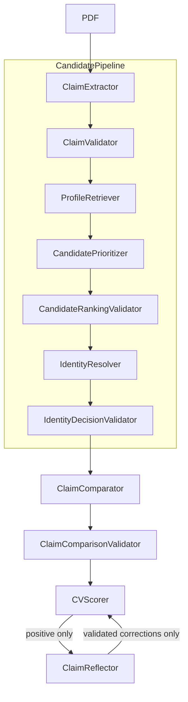

# PR28 — Production reliability hardening

Frozen sequence 5 achieved **10/10 complete public runs, 70/70 classifications, all 30 negatives at supported 0.1**, with no fallback or final stage error. The latest 25-case run in that same grader environment achieved 23/23 known labels, 35/35 targets and 446/446 grounded claims. All earlier failed sequences and control batches remain disclosed below.

PR27 was confirmed merged before implementation. Base: `75355c486f75b8766600fe0bd69908fc79749e4e`. Production remains ClaimComparator plus conditional ClaimReflector; no hybrid components, Facebook, new agent stages, discovery queries, threshold changes, or protected-runner edits.



## Diagnoses and changes

| Observed failure | Recovered evidence | Narrow correction |
|---|---|---|
| CV3 invalid shortlist exhausted eight attempts | PR25 run 3 retains returned hits, invalid-ID error and attempted IDs. Correct profile 6541 was tenth in original search order, never retrieved. | Stable fallback orders actual returned IDs by explicit CV support for observed industry labels, then location. Same ordering applies after a valid shortlist. No hits discarded; eight attempts remain the limit. Offline replay moves 6541 first. |
| CV6 wrong identity | PR25 run 1 selected 8715 after the five shortlisted profiles. Correct 6561 was in search hits but absent from the resolver's profiles. Selected person shared name/city/skills but employers, school, degree and dates disagreed. | Existing identity validator rejects broad matches when both career histories are available. A shared employer now needs related role and dated support; a school needs corroborating degree/year evidence. Distinctive dated-record support can survive a fabricated employer/school. Sparse histories stay with the semantic resolver. Existing investigation continues after rejection. Replay rejects 8715 and places 6561 sixth, within budget. This is both a coverage and an unsupported-selection failure. |
| CV5 malformed location | Saved error: one current candidate with null location value; no extraction response was retained. | One re-extraction from the original CV with validator feedback after parse/schema failure; the unchanged ClaimValidator must accept it before discovery. Synthetic schema reproduction; no inferred repair. |
| CV7 comparison contract failure | Saved error and selected profile 9590 establish a null evidence citation failure. Exact historical model response is unavailable. | Explicit non-null permitted paths plus one comparison contract retry. Synthetic null/nonexistent-path reproductions. |
| `skill_alias` null citation | PR27 raw response cites `experience.1.end_year = null` alongside `is_current` for a current-role MATCH. | Same strict path list/retry. Null paths still fail validation. All six PR28 structured runs pass this case. |
| Sequence 1 / run 4 CV5 UNKNOWN | Correct identity 1297; explicit Senior Analyst versus aligned Analyst/junior was UNKNOWN. Positive-only reflection was skipped. | A second revision allowed narrowly supported UNKNOWN-grade reflection. Sequence2 later disproved its sufficiency; that extension was removed from the final diff. |
| Sequence 2 / run 9 CV5 false valid | Same correct claims/profile. Comparator falsely said Senior Analyst matches Analyst/junior “because seniority is not separately claimed”; reflector returned no corrections. Invalid ranking was recovered; an incomplete comparison also retried. | Final validator adjudicates only an explicit senior/junior/mid conflict on one baseline-aligned record, corroborated by identical employer, base role and all stated dates/current status. Duplicate matching records, missing facts and unresolved aliases skip automatic adjudication. Evidence is reconstructed from the actual profile and full validation runs again. No model stage or identity assumption is added. |
| Sequence 3 / run 6 CV3 wrong identity | Selected 3671 shared only Innovate HK Ltd; Engineer/2006–2009 disagreed with Manager/2023–2026. School, degree, graduation year and city also disagreed. Correct 6541 remained unretrieved at ranking position 6. | Reject an isolated employer without supporting role/date evidence, then continue existing investigation. Offline replay rejects 3671. No search change or budget increase. |
| Sequence 4 / run 5 CV7 extraction failed twice | Both attempts failed the same strict location invariant. Original rejected objects were not retained; the documented inconsistency is reproduced generically. | Second extraction now receives validator feedback and the unchanged original CV, explicitly preserving ambiguity. Still two attempts, still full validation before search. Rejected objects are logged from this revision onward. |

Extraction and comparison application retries are each limited to one extra attempt, inside the existing 180-second per-CV deadline. Existing SDK transport retry settings are unchanged. API failures do not start a new application retry. Invalid citations never enter findings. After malformed output, independently contract-valid, uniquely referenced MISMATCH findings survive an unrelated failure; rejected/missing claims become UNKNOWN. Partial recovery cannot yield 0.9. Contract validation establishes supplied evidence grounding, not semantic infallibility.

The literal CLI now emits `CV_DIAGNOSTIC` records to stderr with runtime, token usage and the returned stage results, including errors and citations. Retry warnings are visible separately. Expected labels and filenames never enter model inputs.

## Deterministic verification

- Initial 11 generic regressions against the unchanged PR27 source: 7 assertion failures and 2 errors, with 2 existing safety controls passing. All 11 pass after the first fix.
- The new UNKNOWN-grade reproductions fail against `e937efc` (4 assertion failures across 2 methods); all 3 new test methods passed in that revision. The final correction replaces this approach. Controls cover missing evidence, matching grades, unqualified titles, ambiguous records, empty corrections and failed/invalid audits.
- Final suite: 194 production tests plus 12 evaluator tests pass. Existing strict null/location validation, eight-attempt limits, invalid IDs, unresolved-score handling and failed-reflection preservation remain covered.
- Protected-runner SHA256 remains `4b8b874090e522ed848750ba8c2292d97701bf4a9a7f8bd9a4cf67a716b43292`; no dependency changes.

The final grade regressions fail against `3043bda` for both UNKNOWN and incorrect MATCH with an empty reflector; malformed optional search metadata also reproduces an exception. Final controls cover duplicate corresponding records, missing grades, unqualified titles, matching grades and changed employer/dates. All 18 final hardening tests pass; all other existing tests pass.

The isolated-employer regression fails against `574f52f` and passes after corroboration is required.

The extraction-feedback regression fails against `8074f50` and passes after the second attempt receives the error and original source. The first extraction prompt/messages are unchanged.

## Structured evaluation

All 25 retained controls and the same saved inputs were used in each iteration. Case SHA256: `20d673be7bff7cbe7ce58d1023d67ecdb71fcc391fbdfbee1be9ed4587f2adcf`. Expected answers stay in the evaluator, outside prompts.

Development-environment batches (all attempts):

| Metric | `e937efc` | `3043bda` superseded | `574f52f` | `8074f50` | Final `8017dc2` |
|---|---:|---:|---:|---:|---:|
| Known-label binary accuracy | 23/23 | 23/23 | 23/23 | 23/23 | 23/23 |
| Genuine uncertainty controls | 2/2 | 2/2 | 2/2 | 2/2 | 2/2 |
| Target claims | 34/35 | 35/35 | 35/35 | 35/35 | 35/35 |
| Catalog / grounded correct claims | 442/446 | 445/446 | 445/446 | 443/446 | 444/446 |
| False valid / false discrepant | 0 / 0 | 0 / 0 | 0 / 0 | 0 / 0 | 0 / 0 |
| Verified 0.1 negatives | 11 | 11 | 11 | 11 | 11 |
| 0.5 processing fallbacks | 0 | 0 | 0 | 0 | 0 |
| Wrong-record citations | 1 | 0 | 0 | 0 | 0 |
| Rejected reflection corrections | 1 | 1 | 0 | 0 | 1 |
| Final comparison failures / contract retries | 0 / 0 | 0 / 0 | 0 / 1 | 0 / 1 | 0 / 0 |
| LLM calls (comparison / reflection) | 38 (25 / 13) | 38 (25 / 13) | 38 (26 / 12) | 38 (26 / 12) | 37 (25 / 12) |
| Input / output / total tokens | 98,697 / 21,662 / 120,359 | 100,860 / 20,906 / 121,766 | 97,289 / 21,668 / 118,957 | 97,390 / 21,890 / 119,280 | 95,122 / 20,654 / 115,776 |
| Batch wall / sum case seconds | 35.29 / 97.72 | 34.34 / 95.72 | 34.53 / 98.57 | 34.18 / 97.33 | 34.38 / 97.19 |

Grounded accuracy requires the expected status and no off-anchor record citation. The first iteration's wrong-record citation was already a wrong-status claim, so it does not subtract a second claim. Every attempted structured run is reported. Revisions 3/4 each recovered one contract-invalid comparison with one fully validated retry. `skill_alias` passes in all five batches.

The last development batch still had semantic errors: `fabricated_employer/jobs.0.title` and `fabricated_school/jobs.1.is_current` are MISMATCH rather than expected MATCH. Binary discrepancies remain independently supported by the fabricated employer/school. That development batch's rejected reflection in `bsc_alias` proposed an unsupported title/grade correction; strict validation preserved 0.9. Earlier batches over-propagated the fabricated employer to start year/current status, or cited another record for an extra fabricated job. These semantic/correspondence weaknesses are not removed by contract hardening. Revisions 3/4/5 have identical verification code and fixed inputs: the 445/443/444 claim results reflect model variation, not changes to upstream stages (extraction and identity selection are bypassed in these controls).

Single stochastic batches cannot attribute claim-level differences causally to hardening. Historical PR27 had 22/23, 34/35 targets, 426/446 catalog claims, 38 calls, 115,997 tokens and 34.12 seconds. The final batch uses 115,776 tokens and 37 calls versus historical 115,997 tokens and 38 calls. Explicit-grade adjudication adds no model call and can avoid a reflection; response lengths and timings also vary. This historical comparison gives cost scale, not a controlled causal latency result.

The five development batches used the existing environment: LangChain 1.4.4/core 1.6.9. The exact lecturer pip setup installed LangChain 1.4.6/core 1.6.11 for every native sequence. DeepSeek adapter 1.1.1, MCP adapters 0.3.2 and MarkItDown 0.1.8 match. The final 194 production and 12 evaluator tests also pass in this grader environment. A sixth 25-case batch was run there after acceptance, with unchanged production bytes and saved inputs; all 25 initial comparison messages are byte-identical to the preceding development batch. This environment difference is disclosed rather than attributed to architecture.

| Final matched grader environment (`8017dc2`) | Result |
|---|---:|
| Known-label accuracy / uncertainty controls | 23/23 / 2/2 |
| Target / catalog / grounded accuracy | 35/35 / 446/446 / 446/446 |
| False valid / false discrepant / wrong-record citations | 0 / 0 / 0 |
| Verified 0.1 negatives / genuine 0.5 controls | 11 / 2 |
| Processing errors / contract retries | 0 / 0 |
| Model calls (comparison / reflection) | 37 (25 / 12) |
| Input / output / total tokens | 95,026 / 20,977 / 116,003 |
| Batch wall / sum case seconds | 32.99 / 93.41 |

The clean sixth batch does not erase the two same-source errors observed in the preceding batch. No code was changed to obtain these different claim judgments.

Latest matched-environment case outcomes (0.5 below is genuine uncertainty, not processing failure):

| Case | Score | Target correct | Catalog correct | Visible errors |
|---|---:|---:|---:|---|
| `mba_alias` | 0.9 | 2/2 | 18/18 | none |
| `start_year_contradiction` | 0.1 | 1/1 | 18/18 | none |
| `fabricated_employer` | 0.1 | 1/1 | 18/18 | none |
| `employment_exact_years` | 0.9 | 2/2 | 14/14 | none |
| `end_year_contradiction` | 0.1 | 1/1 | 18/18 | none |
| `false_current_employment` | 0.1 | 1/1 | 17/17 | none |
| `title_plus_seniority_equivalence` | 0.9 | 2/2 | 19/19 | none |
| `explicit_seniority_contradiction` | 0.1 | 1/1 | 18/18 | none |
| `unqualified_title_extra_grade` | 0.9 | 1/1 | 18/18 | none |
| `employer_alias` | 0.9 | 1/1 | 18/18 | none |
| `reordered_employment` | 0.9 | 2/2 | 18/18 | none |
| `ambiguous_record_details` | 0.5 | 1/1 | 15/15 | none |
| `graduation_year_contradiction` | 0.1 | 1/1 | 18/18 | none |
| `bsc_alias` | 0.9 | 1/1 | 18/18 | none |
| `school_alias` | 0.9 | 1/1 | 18/18 | none |
| `fabricated_school` | 0.1 | 1/1 | 18/18 | none |
| `fabricated_degree` | 0.1 | 1/1 | 18/18 | none |
| `exact_skill` | 0.9 | 1/1 | 16/16 | none |
| `skill_alias` | 0.9 | 1/1 | 18/18 | none |
| `fabricated_skill` | 0.1 | 1/1 | 18/18 | none |
| `missing_skills_evidence` | 0.5 | 3/3 | 18/18 | none |
| `explicit_current_city` | 0.9 | 1/1 | 18/18 | none |
| `ambiguous_city_header` | 0.9 | 1/1 | 18/18 | none |
| `hometown_is_not_current_city` | 0.1 | 1/1 | 18/18 | none |
| `additional_fabricated_job` | 0.1 | 5/5 | 23/23 | none |

## Exact public acceptance protocol

Used the assignment's GitHub clone, `python3 -m venv .venv`, activation, `pip install -r requirements.txt`, existing `.env` API configuration, and literal command:

```bash
python3 hw2.py --cv-folder public_test
```

Seven original PDFs only. DeepSeek `deepseek-v4-flash`, thinking disabled; SocialGraph MCP; concurrency 3; 180 seconds per CV; threshold 0.5. No patches, alternate runners, injected answers or synthetic PDFs. The outer shell only times commands, preserves CSV/log files and grades afterward. Source/config/PDF hashes are checked between runs; dependency versions are frozen per sequence. Sequences 2/3/4/5 updated only source before their freezes, retaining the same fresh pip environment. Python 3.14.0; LangChain 1.4.6, core 1.6.11, DeepSeek adapter 1.1.1, MCP adapters 0.3.2, MarkItDown 0.1.8.

Binary classes below use >0.5 = valid (V), otherwise discrepant (D). Thus 0.9 is V; both 0.1 and 0.5 are D. CV1/2/3/6 are expected V; CV4/5/7 expected D. The additional acceptance criterion rejects a 0.5 even if its binary class happens to be correct.


## Public acceptance history

### Sequence 1 — `e937efc`

Stopped at run 4: CV5 UNKNOWN/0.5. Binary accuracy alone passed, additional acceptance failed.

| Run | CV1 | CV2 | CV3 | CV4 | CV5 | CV6 | CV7 | Correct | Seconds | Visible errors/recovery |
|---|---|---|---|---|---|---|---|---:|---:|---|
| 1 | 0.9 V | 0.9 V | 0.9 V | 0.1 D | 0.1 D | 0.9 V | 0.1 D | 7/7 | 46 | none |
| 2 | 0.9 V | 0.9 V | 0.9 V | 0.1 D | 0.1 D | 0.9 V | 0.1 D | 7/7 | 39 | none |
| 3 | 0.9 V | 0.9 V | 0.9 V | 0.1 D | 0.1 D | 0.9 V | 0.1 D | 7/7 | 39 | none |
| 4 | 0.9 V | 0.9 V | 0.9 V | 0.1 D | 0.5 D | 0.9 V | 0.1 D | 7/7 | 39 | 1 contract warnings; 0.5 acceptance failure |

### Sequence 2 — `3043bda`

Stopped at run 9: CV5 false valid; both comparator and reflector missed the explicit grade.

| Run | CV1 | CV2 | CV3 | CV4 | CV5 | CV6 | CV7 | Correct | Seconds | Visible errors/recovery |
|---|---|---|---|---|---|---|---|---:|---:|---|
| 1 | 0.9 V | 0.9 V | 0.9 V | 0.1 D | 0.1 D | 0.9 V | 0.1 D | 7/7 | 39 | CV_3: reflection |
| 2 | 0.9 V | 0.9 V | 0.9 V | 0.1 D | 0.1 D | 0.9 V | 0.1 D | 7/7 | 40 | CV_3: reflection |
| 3 | 0.9 V | 0.9 V | 0.9 V | 0.1 D | 0.1 D | 0.9 V | 0.1 D | 7/7 | 39 | CV_2: reflection |
| 4 | 0.9 V | 0.9 V | 0.9 V | 0.1 D | 0.1 D | 0.9 V | 0.1 D | 7/7 | 40 | none |
| 5 | 0.9 V | 0.9 V | 0.9 V | 0.1 D | 0.1 D | 0.9 V | 0.1 D | 7/7 | 39 | none |
| 6 | 0.9 V | 0.9 V | 0.9 V | 0.1 D | 0.1 D | 0.9 V | 0.1 D | 7/7 | 39 | none |
| 7 | 0.9 V | 0.9 V | 0.9 V | 0.1 D | 0.1 D | 0.9 V | 0.1 D | 7/7 | 45 | none |
| 8 | 0.9 V | 0.9 V | 0.9 V | 0.1 D | 0.1 D | 0.9 V | 0.1 D | 7/7 | 38 | none |
| 9 | 0.9 V | 0.9 V | 0.9 V | 0.1 D | 0.9 V | 0.9 V | 0.1 D | 6/7 | 39 | CV_5: prioritization; 1 contract warnings; classification failure |

### Sequence 3 — `574f52f`

Stopped at run 6: CV3 wrong identity caused a false discrepant result. This is an identity-stage failure; grounded citations against the wrong person are not verification of CV fraud.

| Run | CV1 | CV2 | CV3 | CV4 | CV5 | CV6 | CV7 | Correct | Seconds | Visible errors/recovery |
|---|---|---|---|---|---|---|---|---:|---:|---|
| 1 | 0.9 V | 0.9 V | 0.9 V | 0.1 D | 0.1 D | 0.9 V | 0.1 D | 7/7 | 38 | none |
| 2 | 0.9 V | 0.9 V | 0.9 V | 0.1 D | 0.1 D | 0.9 V | 0.1 D | 7/7 | 39 | none |
| 3 | 0.9 V | 0.9 V | 0.9 V | 0.1 D | 0.1 D | 0.9 V | 0.1 D | 7/7 | 39 | none |
| 4 | 0.9 V | 0.9 V | 0.9 V | 0.1 D | 0.1 D | 0.9 V | 0.1 D | 7/7 | 39 | none |
| 5 | 0.9 V | 0.9 V | 0.9 V | 0.1 D | 0.1 D | 0.9 V | 0.1 D | 7/7 | 40 | none |
| 6 | 0.9 V | 0.9 V | 0.1 D | 0.1 D | 0.1 D | 0.9 V | 0.1 D | 6/7 | 39 | classification failure; wrong CV3 identity |

### Sequence 4 — `8074f50`

Stopped at run 5: CV7 extraction failed twice and produced an accidental correct-negative 0.5.

| Run | CV1 | CV2 | CV3 | CV4 | CV5 | CV6 | CV7 | Correct | Seconds | Visible errors/recovery |
|---|---|---|---|---|---|---|---|---:|---:|---|
| 1 | 0.9 V | 0.9 V | 0.9 V | 0.1 D | 0.1 D | 0.9 V | 0.1 D | 7/7 | 41 | CV_2: reflection; 1 contract warnings |
| 2 | 0.9 V | 0.9 V | 0.9 V | 0.1 D | 0.1 D | 0.9 V | 0.1 D | 7/7 | 42 | none |
| 3 | 0.9 V | 0.9 V | 0.9 V | 0.1 D | 0.1 D | 0.9 V | 0.1 D | 7/7 | 42 | none |
| 4 | 0.9 V | 0.9 V | 0.9 V | 0.1 D | 0.1 D | 0.9 V | 0.1 D | 7/7 | 42 | CV_2: identity |
| 5 | 0.9 V | 0.9 V | 0.9 V | 0.1 D | 0.1 D | 0.9 V | 0.5 D | 7/7 | 32 | CV_2: reflection; CV_7: extraction; 2 contract warnings; 0.5 acceptance failure |

Reflection errors above reject unsupported title/grade corrections and preserve validated positive baselines. Sequence 4 / run 4 identity JSON parsing failed, then the existing bounded investigation resolved the correct identity. Sequence 2 / run 9 also records an incomplete-comparison repair warning; the native warning alone does not identify its CV. No such warning is assumed to cause the observed false valid.

### Sequence 5 — `8017dc29bd721e9c79b195a3d28b1eb4ec249b7e` — acceptance achieved

Ten consecutive complete CLI runs: 70/70 classifications, 30/30 expected negatives at supported 0.1, no wrong identity, false valid, false discrepant, UNKNOWN finding, 0.5 fallback, final stage error or partial comparison recovery. All source/data hashes and dependency versions were verified unchanged after run 10. One malformed comparison envelope in run 1 recovered through the bounded retry.

| Run | CV1 | CV2 | CV3 | CV4 | CV5 | CV6 | CV7 | Correct | Seconds | Recovery |
|---|---|---|---|---|---|---|---|---:|---:|---|
| 1 | 0.9 V | 0.9 V | 0.9 V | 0.1 D | 0.1 D | 0.9 V | 0.1 D | 7/7 | 42 | one comparison retry |
| 2 | 0.9 V | 0.9 V | 0.9 V | 0.1 D | 0.1 D | 0.9 V | 0.1 D | 7/7 | 38 | none |
| 3 | 0.9 V | 0.9 V | 0.9 V | 0.1 D | 0.1 D | 0.9 V | 0.1 D | 7/7 | 40 | none |
| 4 | 0.9 V | 0.9 V | 0.9 V | 0.1 D | 0.1 D | 0.9 V | 0.1 D | 7/7 | 39 | none |
| 5 | 0.9 V | 0.9 V | 0.9 V | 0.1 D | 0.1 D | 0.9 V | 0.1 D | 7/7 | 41 | none |
| 6 | 0.9 V | 0.9 V | 0.9 V | 0.1 D | 0.1 D | 0.9 V | 0.1 D | 7/7 | 40 | none |
| 7 | 0.9 V | 0.9 V | 0.9 V | 0.1 D | 0.1 D | 0.9 V | 0.1 D | 7/7 | 40 | none |
| 8 | 0.9 V | 0.9 V | 0.9 V | 0.1 D | 0.1 D | 0.9 V | 0.1 D | 7/7 | 40 | none |
| 9 | 0.9 V | 0.9 V | 0.9 V | 0.1 D | 0.1 D | 0.9 V | 0.1 D | 7/7 | 40 | none |
| 10 | 0.9 V | 0.9 V | 0.9 V | 0.1 D | 0.1 D | 0.9 V | 0.1 D | 7/7 | 41 | none |

Selected profile IDs in every accepted run: CV1=6337, CV2=47, CV3=6541, CV4=8235, CV5=1297, CV6=6561, CV7=9590. These are audit results, never production rules or prompt inputs. Each run has exactly the three intended MISMATCH findings: CV4 `jobs.0.start_year` (2015 versus 2014); CV5 `jobs.1.title` (Senior Analyst versus the aligned Analyst/junior role, matching employer and 2007–2008 dates); CV7 `skills.0.name` (Docker absent from the explicit complete profile skill list). All other findings are MATCH. Every negative was revalidated against its selected captured profile.

All 34 attempted complete public runs are disclosed: 236/238 binary decisions correct, including one older false valid and one older false discrepant caused by a wrong identity. Two other older correct-negative classifications were 0.5 fallbacks and failed acceptance. These mixed-version totals are history, not the final frozen acceptance sample. No sequences were combined to obtain ten passes.

## Cost, latency and limitations

| Sequence | Runs | Correct | Stage-derived LLM calls* | Tokens | Sum batch seconds | Max CV seconds | 0.5 results | CVs with visible errors | Contract warnings |
|---|---:|---:|---:|---:|---:|---:|---:|---:|---:|
| 1 | 4 | 28/28 | 132 | 331,373 | 163 | 24.16 | 1 | 0 | 1 |
| 2 | 9 | 62/63 | 299 | 754,097 | 358 | 17.31 | 0 | 4 | 1 |
| 3 | 6 | 41/42 | 194 | 481,028 | 234 | 16.54 | 0 | 0 | 0 |
| 4 | 5 | 35/35 | 160 | 395,435 | 199 | 17.94 | 1 | 4 | 3 |
| 5 | 10 | 70/70 | 322 | 800,308 | 401 | 17.39 | 0 | 0 | 1 |

*Native token usage comes from LangChain's usage callback. Native model-call counts are inferred from the completed extraction/ranking/identity/comparison/reflection stages and explicit contract retries; they are not HTTP-attempt counts. SDK transport retry billing is not separately observable. Structured model calls are directly captured by the existing evaluator. No API failures or missing token usage were recorded in the structured batches.

The accepted ten runs use 800,308 tokens and 401 total batch seconds (38–42 seconds per complete seven-CV run, mean 40.1). Slowest CV: 17.39 seconds. Stage-derived calls total 322: normal completed paths plus one comparison repair and one extra existing identity-resolution round. No extraction retry was needed in that final sequence; the feedback path is covered deterministically, not claimed as naturally exercised there. Evidence-path lists add input context; normal paths add no application retry call. Maximum extra recovery calls: one extraction plus one comparison, both inside the unchanged deadline. Grade adjudication adds no model call. No dollar estimate is inferred from token totals.

All six structured batches used 226 directly recorded model calls and 712,141 tokens. All 34 public batches used 2,762,241 callback-reported tokens. The evaluation itself is more expensive than a single grader run; its failures are included in these totals.

Recommend retaining the existing production comparator/reflection architecture with these reviewed hardening changes for Task1. The final sequence meets the requested public acceptance target. It does not establish unseen-set reliability or zero future failure probability: all runs reuse seven CVs and share the same model/server. Fully aliased or corrupted career histories can remain unresolved under the identity veto; eight attempts can still omit the correct person. The grade rule deliberately leaves ambiguous/uncorroborated records and general semantic equivalence to the comparator. The earlier same-source structured claim errors and occasional rejected reflection outputs remain observed weaknesses. Contract-valid evidence is not proof of perfect semantic judgment.

## Reproduction, artifacts and rollback

Production freeze: `8017dc29bd721e9c79b195a3d28b1eb4ec249b7e`. The PR's later report-only commit does not change production bytes. Re-run the tests and controls from the repo root:

```bash
python3 -m unittest discover -s test -q
python3 -m unittest discover -s evaluation -p 'test_*.py' -q
python3 -m evaluation.run_controlled --output evaluation/results/pr28/reproduction.json
python3 hw2.py --cv-folder public_test
```

Use the assignment's clone/venv/pip/.env setup first. Preserve each resulting `results.csv` before the next literal CLI run. Stochastic outputs need not be byte-identical.

Raw results remain ignored locally under `evaluation/results/pr28/`: `extended.json`, `extended_v2.json` through `extended_v5.json`, `extended_fresh.json`, before/after regression logs, complete test logs, and `sequence_1/` through `sequence_5/` (every CSV, full CLI diagnostic log, per-run summary, source/data/dependency manifest). The same native captures remain in `.venv/pr28-grader/evaluation/results/pr28/`. They are not imported by submission code or sent back as model input. Summary tables above are committed for review; raw mock profiles and responses stay out of the PR.

`artifacts_manifest.json` inventories 146 immutable raw evidence files by SHA256; manifest SHA256: `2cfd61c2a1ccabaad163d33142852ee0be0465f26b6ea967573d4eb32ef49e03`. `sequence_5/freeze_verified.json` records the final source/data/dependency check. Native CLI retains final stage results, not every model's raw response; missing historical extraction/comparison responses are explicitly identified above.

Rollback: revert this PR's commits (newest first) to restore PR27 behavior, or use base commit `75355c486f75b8766600fe0bd69908fc79749e4e`. No dependency, schema migration or data rollback is required. Do not merge automatically; stop for review.
