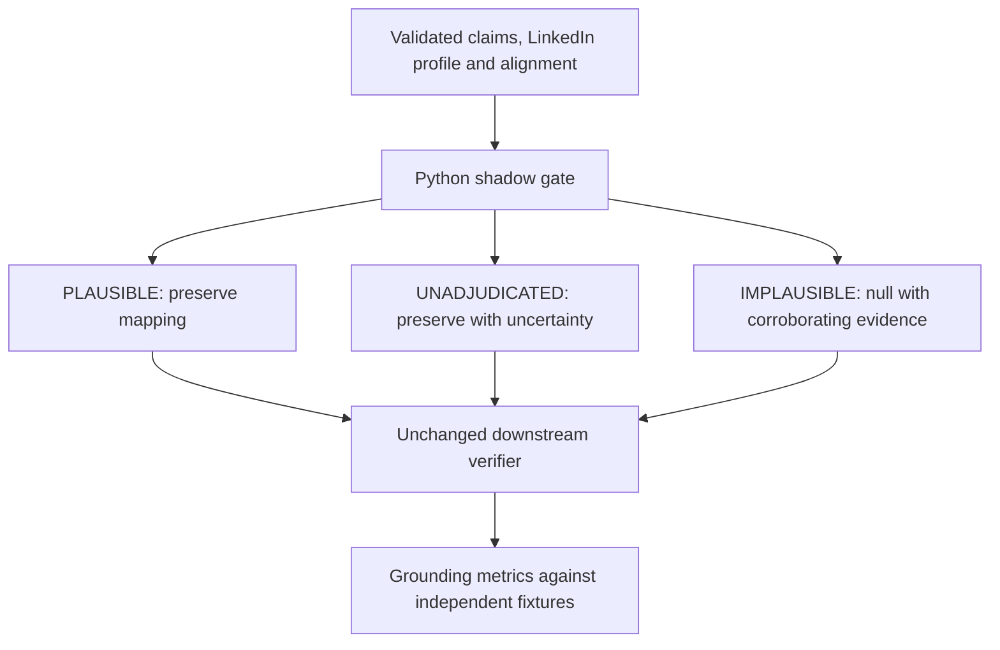

# Correspondence plausibility gate: shadow evaluation

**Recommendation: retain as a diagnostic only.** The conservative gate caught six of seven deliberately wrong input correspondences and rejected none of 105 correct correspondences in the paired run. However, it left one adversarial wrong mapping `UNADJUDICATED`; unchanged verification then produced four unsafe definite findings. Nulling the two valid employment swaps also left both whole-CV scores at 0.5, which the assignment threshold still classifies as discrepant. The experiment does not support using this gate to authorize factual verification or scoring.

No production code changed. The gate, fixtures, runner and tests are development-only files under `evaluation/`.

## Scope and rule selection

The gate receives validated claims, a selected LinkedIn profile and validated jobs/education alignments. It makes no model or MCP calls, does not change source facts and never assigns an alternative profile index. For each record it emits one decision, evidence paths/values and a reason:

- `PLAUSIBLE` retains a correspondence when multiple identity, role and/or time attributes support it. A discrepancy in a single CV attribute does not defeat the mapping.
- `UNADJUDICATED` retains the mapping and says it is not independently verified. Existing nulls stay null; missing or unusable comparison fields do not create an implausible result.
- `IMPLAUSIBLE` nulls the mapping only when the assigned record conflicts across identity and time and an alternative record supplies positive corroboration. The alternative is diagnostic evidence only; the gate does not realign.

Candidate rules were checked offline before selecting that conflict-and-alternative rule. The probe contains 80 correct input-mapping rows and seven intentionally wrong rows, with repeated controls from three saved CV identities; these counts are not independent sample estimates.

| Candidate rule | Correct rows rejected | Wrong rows caught | Why it was not selected |
|---|---:|---:|---|
| Require every compared field to agree | 27/80 | 7/7 | Rejects correct rows with a genuine false date, fabricated employer/school, and aliases. |
| Require at least two exact field matches | 1/80 | 6/7 | Rejects sparse but valid correspondence and misses the false-employer stress case. |
| Require at least three exact field matches | 4/80 | 7/7 | Rejects a true graduation-year discrepancy, school alias and fabricated-school claim. |
| Prefer any alternative with a higher match count | 1/80 | 7/7 | Can select a duplicate/contextually ambiguous record. |
| Require identity-and-timeline conflict plus a corroborating alternative | 0/80 | 6/7 | Most conservative observed rule, but the adversarial false-employer mapping remains unresolved. |

The selected rule recognizes ordinary exact aliases only where other attributes support correspondence. Unknown wording does not count as a contradiction. Employment end year and currentness are treated as related terminal-state evidence rather than separate independent votes. Education rejection requires school and graduation-year conflicts, with neither degree nor field supporting the assignment, plus an alternative with school/year and degree or field support.

## Paired evaluation

The bounded run used 42 cases: 25 saved controls, 10 PR #20 record injections, three synthetic uncertainty controls, one added-record education stress and three synthetic negative stresses. There were 37 binary-labelled cases and five uncertainty cases. Cases reuse three public CV identities and derived copies; results are bounded evidence, not a reliability estimate.

| Measure | Validated injected alignment | After gate |
|---|---:|---:|
| Incorrect correspondences in input | 7 | 7 |
| Incorrect correspondences nulled | — | 6/7 |
| Correct correspondences nulled | — | 0/105 |
| Whole-CV accuracy on binary cases | 33/37 | 34/37 |
| False-discrepant whole-CV labels | 4 | 3 |
| Grounded claim accuracy | 93.2% (698/749) | 94.4% (707/749) |
| Target claim accuracy | 71.6% (83/116) | 74.1% (86/116) |
| Unsafe definite claim findings | 23 | 4 |
| UNKNOWN claims | 37 | 47 |
| Unverified expected discrepancies | 6 | 6 |
| Verified expected-discrepancy cases | 16 | 16 |

`false_valid` classifications were zero on both paths. One semantic contract failure occurred on each path and was isolated; no MCP calls or gate/model retries occurred. A score of 0.5 remained uncertainty, not a verified discrepancy.

The gate returned 101 `PLAUSIBLE`, 19 `UNADJUDICATED` and six `IMPLAUSIBLE` decisions. Of the 19 unadjudicated records, 12 were pre-existing nulls and seven still had an assigned profile index. The mapped unadjudicated group retained four grounded true discrepancies and had 11 subsequent semantic recoveries, but it also produced four unsafe definite findings and left one expected discrepancy unverified. The unsafe findings are concentrated in `false_employer_matches_wrong_record`: the CV employer was changed to the employer on the wrong assigned record while the role and dates still identified a different record. The gate preserved that mapping as unadjudicated; unchanged deterministic verification cited it and returned an incorrect employer `MATCH` plus incorrect start/current `MISMATCH` findings. This is the unresolved cost of preserving uncertain correspondences.

Nulling the six implausible correspondences exposed 27 associated claim outcomes: 9 were correctly grounded after semantic resolution and 18 abstained as `UNKNOWN`. The education stress recovered all four claims. The two originally valid swapped-employment CVs each ended at 0.5 in the full run. Their score changed from 0.1, but the threshold still labelled them discrepant; this is not a recovered valid CV. The separate three-case pilot did recover those two CVs, which shows the semantic outcome varied between the pilot and full run. The full 42-case result is the primary evaluation; the pilot is not an extra sample.

The true Deloitte start-year discrepancy (CV 2021 vs LinkedIn 2020) stayed aligned, produced a grounded `MISMATCH`, and scored 0.1. The Carousell end-year discrepancy, false-current claim, explicit seniority contradiction, fabricated employer, fabricated school and fabricated degree controls also retained their expected aligned-record judgments. Aliases, reordered records, unavailable fields and pre-existing nulls were not rejected merely for lacking exact matches.

## Uncertainty, inference and latency

Unadjudicated diagnostics were kept outside the verifier inputs. For aligned records the unchanged neutral correspondence reason was supplied downstream; therefore the gate itself did not certify an unadjudicated mapping. Grounding and unsafe-claim counts were assessed separately against fixture correspondences and expected claim statuses.

The model was `deepseek-v4-flash`, JSON output, thinking disabled, zero retries and concurrency three. In the full 42-case run, the ungated path made 42 semantic calls (61,078 input and 5,838 output tokens). The gated path made four calls (8,440 input and 1,428 output tokens); 37 unchanged paths reused the exact control response, and the one unchanged processing failure was replayed as a failure. The paired full run therefore used 46 calls and 76,784 reported tokens; this is not a standalone gated-runtime cost. Summed call latency was 54.41 seconds ungated and 7.71 seconds gated; full-run wall time was 22.98 seconds. Gate CPU time summed to 0.0047 seconds. The gate made zero model calls and zero MCP calls.

The preliminary three-case slice used three ungated and two gated model calls (11,876 tokens total; 4.96 seconds wall time). Across both runs, the live experiment used 51 calls and 88,660 reported tokens. The slice is reported to show model-output variability and is not included as another sample.

Validation: 304 deterministic tests passed (242 existing component tests, 37 existing evaluation tests, 25 new gate tests). The shadow files do not alter extraction, identity resolution, objective verification, scoring, timeouts, concurrency or the supplied runner.
