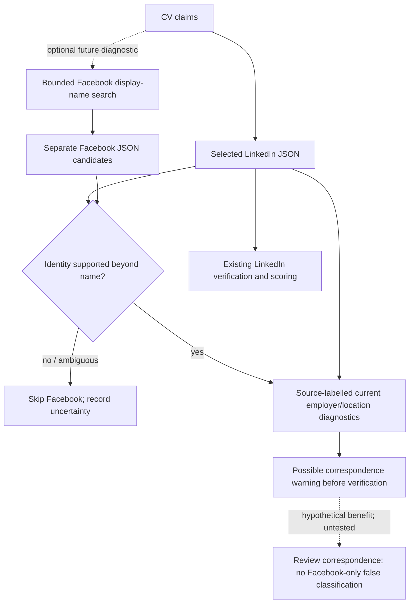

# Dual-source evidence reconnaissance (PR #21)

**Recommendation:** do not retrieve Facebook unconditionally or build a dual-source EvidenceAligner on these observations. Facebook supplies useful current-employer and location corroboration, but no structured employment history, dates, seniority or skills. Its discovery is unreliable for changed display names, and independence from LinkedIn is unestablished. No production verification or scoring was changed.

## Sources and method

Dependency: [PR #20](https://github.com/alistairkung/FTEC5660-HW2/pull/20) merged into `task1-scoring-integration` as `648318da0a98cd4b76336d011ac2b268c99a4a47`; this investigation branches from that baseline.

The only live evidence source was the supplied SocialGraph MCP server. The development snapshot was collected on 2026-10-13, 15:39:21–15:42:08 UTC. Raw responses remain ignored by Git at `/Users/alistair/projects/FTEC/FTEC5660-HW2/evaluation/results/pr21_dual_source.json`. Snapshot SHA-256: `c73b2ef33d43eb4a09a1576e94f19a5160800aa4452e669514b499c057946e51`.

Source labels below refer to that snapshot: **S0** = `tool_schemas`; **S1–S17** = `calls[0]` through `calls[16]`, including arguments, raw response and per-call seconds. **CV** = the three saved public inputs in `/Users/alistair/projects/FTEC/FTEC5660-HW2/evaluation/saved_public_inputs.json`. **R20** = the ignored `/Users/alistair/projects/FTEC/FTEC5660-HW2/evaluation/results/pr20_injection_pair.json`, `records` for `wrong_jobs_logistics` and `wrong_jobs_engineering`. Live LinkedIn refreshes (S2/S4/S6) exactly equalled all three saved profiles. Saved-input SHA-256: `354c704933523ee238db5bb3ebc1932fa94a8465a9b30a06be226ac4cd49f252`.

This was manual, source-aware reconnaissance, not a rerun of the verifier or a measured alignment intervention. Three content-supported dataset pairs were inspected, along with three same-name/location decoys. The investigation stopped once missing history and identity-discovery limitations were established.

## Actual tools and schema

The server exposes six tools (S0):

| Tool | Arguments and available evidence |
|---|---|
| `search_facebook_users` | Required `q`; optional `location`, `limit` (default/max 20), `fuzzy` (default true). Searches **display name**, with partial/case-insensitive matching; fuzzy fallback only when exact search finds nothing. Location matches city or country. Results: `id`, `display_name`, `city`, `country`, `match_type`. |
| `get_facebook_profile` | Required integer `user_id` from Facebook search. Actual fields are listed below. Invalid ID returns an error object. |
| `get_facebook_mutual_friends` | Two Facebook user IDs; mutual IDs/count. Not invoked: no independently established relationship anchor. |
| `search_linkedin_people` | `q`, optional location/industry/limit/fuzzy; searches name, headline, summary or skill names. |
| `get_linkedin_profile` | `person_id`; professional identity, location, structured `experience`, `education` and `skills`. |
| `get_linkedin_interactions` | `person_id`; posts/likes and interacting profile IDs. Not invoked. |

All six retrieved Facebook objects had `id` (integer); `display_name`, `original_name`, `city`, `country`, `hometown`, `bio`, `status`, `education`, `current_job`, `current_company`, `interests` (strings); `friend_count` (integer); `friends` (integer array); and `posts` (array of `{id: integer, content: string}`). S0 allows null for several personal/employment fields; these samples were populated. `friend_count` was observed although omitted from the tool's documented return list. There were **no** `experience`/academic-record/skill arrays, employment years, seniority, explicit currentness boolean, post timestamps or profile-update timestamps. Facebook `status` is relationship status, while LinkedIn `status` is employment status; they must not be compared as the same field.

S0 describes `original_name` as the original/legal name **from LinkedIn**. Neither tool schema exposes a LinkedIn-to-Facebook ID reference or guarantees equal numeric IDs. IDs coincided for the three pairs below; that observation is not a stable identity contract.

## Identity matching and discovery

Acceptance required more than names: `FB.original_name == LI.name`, agreement in city/country, and a distinctive near-verbatim `FB.bio` prefix of `LI.summary` (first two sentences, ignoring whitespace/trailing punctuation). Employment was not used to establish identity before checking employer overlap. Angela's Stanford and John's Delhi hometowns also match explicitly labelled CV hometowns. Minh's Hong Kong is present in the CV header without a role label, so it is weaker contextual agreement. These criteria support **three conditional dataset pairs**, not independently authenticated people or globally unique matches.

| Saved identity | Facebook pair | How found; unresolved discovery |
|---|---|---|
| Angela Yip, LI 6337 | FB 6337, **Riley Yip** (S11) | Legal-name + London search returned 11 candidates, excluding this profile (S7). A deliberately untrusted same-ID probe revealed it; subsequent known-display-name search returned two Riley Yips (S16). Ordinary CV-name discovery remains unresolved. |
| Minh Pham, LI 47 | FB 47, **Avery Pham** (S12) | Legal-name + Beijing search returned 17 candidates, excluding this profile (S8). Same-ID probe, then known-display-name search returned one candidate (S17). Ordinary CV-name discovery remains unresolved. |
| John Smith, LI 6541 | FB 6541, John Smith (S10) | Appeared among 11 legal-name + Hyderabad results (S9); full content supported the pair. |

Thus **1/3 pairs was discoverable by the tested CV-name/location search route; 2/3 depended on exploratory ID hypotheses**, subsequently supported by content. Unfiltered legal-name searches each hit the 20-result cap (S1/S3/S5); no exhaustiveness or ranking reliability is established. `match_type: exact` describes the search method, not same-person confidence.

Name/location decoys demonstrate the risk (S13–S15): Angela Yip FB15, London, has Scientist/Gojek, Doctoral Degree, London hometown and a different bio; Minh Pham FB70, Beijing, even shares Hong Kong hometown but has Engineer/Manulife, Master's Degree and a different bio; John Smith FB1194, Hyderabad, has Analyst/GreenLeaf Co, Bachelor's Degree, Hong Kong hometown and a different bio. These are **possible identity mismatches**, not evidence that the CVs are false.

## Field overlap and limitations

Paths below retain platform provenance; `LI(id)` and `FB(id)` identify separate objects, not a combined record.

| Field | Directly observed overlap across the three accepted pairs |
|---|---|
| Name | `FB.original_name` agrees with `LI.name` 3/3; display name agrees 1/3. |
| Current location | `FB.city/country` equals `LI.city/country` 3/3: London/UK, Beijing/China, Hyderabad/India. No update timestamps establish freshness. |
| Current employer/title | 3/3 agree: `FB(6337).current_company/current_job` = Deloitte/Manager vs `LI(6337).experience.1`; FB47 = BCG/Manager vs LI47 `experience.0`; FB6541 = Shopee/Engineer vs LI6541 `experience.1`. Facebook omits the LinkedIn senior/junior grades. |
| Historical employment/dates | 0/3 supplied structured history or start/end years. No Carousell, Tencent or Innovate HK Ltd record appears in these accepted Facebook profiles/posts. Absence is missing evidence, not contradiction. |
| Education | 3/3 broad level agreement: Master's Degree vs MBA; Bachelor's Degree vs BSc; Doctoral Degree vs PhD. `FB.education` supplies no institution, subject or graduation year; it cannot corroborate Stanford/2012, HKU/2011 or Seoul National University/2006. |
| Skills | 0/3 structured skills. FB47 `interests` includes UI/UX; FB6337 includes Operations Management. Interests are not verified professional skills or proficiency. |

There were **zero direct contradictions in accepted pairs' comparable structured fields**. There were ambiguities: FB6337 `posts.0.content` says “One year at Deloitte already!” but has no timestamp, so it cannot establish a start year. Its `posts.3.content`, “London has my heart … Can't wait to come back,” could describe travel rather than a residence change. FB47 `posts.4.content` repeats a Manager role at BCG without dates. John's posts add no employment information. FB47's labelled Hong Kong hometown makes the CV's Beijing/Hong Kong header interpretation plausible, but does not prove the header's intended roles.

The distinctive biography repetition suggests shared dataset provenance; server generation was not inspected or proven. Together with S0's explicit LinkedIn-derived `original_name`, it means **independent corroboration and Facebook trustworthiness have not been established**. Two agreeing endpoints must not count as two independent confirmations.

## PR #20 failure scenarios

| Scenario | Observed failure and Facebook's possible contribution |
|---|---|
| Deloitte/Carousell, Angela | Correct mapping: CV `jobs.0` → LI `experience.1` (Deloitte, Manager/senior, 2020/current); CV `jobs.1` → LI `experience.0` (Carousell, Scientist/senior, 2012–2018/not current). R20 swap produced 8/9 unsafe targets, including four immutable wrong date/currentness judgments. FB6337's Deloitte/Manager could flag the proposed **current Deloitte → historical Carousell** correspondence as suspicious. It cannot corroborate Carousell or either date range, and cannot independently establish the senior grade. |
| Shopee/Innovate HK Ltd, John | Correct mapping: CV `jobs.0` → LI `experience.1` (Shopee, Engineer, 2017/current); CV `jobs.1` → LI `experience.0` (Innovate HK Ltd, Engineer, 2006–2009/not current). Both titles are Engineer, so title agreement alone cannot distinguish them. R20 swap produced 6/9 unsafe targets, including four immutable wrong date/currentness judgments and two coincidental Engineer MATCH labels citing the wrong record. FB6541's Shopee employer could flag the current-record swap; no historical Innovate record or dates are supplied. |

**Hypothetical benefit:** a defensibly identified Facebook current employer could provide a warning before a wrong correspondence reaches immutable verification. **Not observed:** prevention, recovery, improved accuracy, or an independent basis for either historical record. Adding Facebook to later semantic reasoning would not undo R20's eight immutable mistakes under the existing pipeline. LinkedIn already contains the distinguishing employers, dates and current flags; a correspondence plausibility check could use those facts without Facebook. Facebook adds no finer record distinction here, so marginal benefit over such a LinkedIn-only check is unmeasured. A wrong Facebook identity could instead introduce false contradictions, as the decoys show. No Facebook-only evidence was used to classify a CV.

## Cost and smallest useful architecture

This investigation made **17 MCP tool calls**: eight Facebook searches, six Facebook profile fetches (three accepted/three decoys), and three LinkedIn refreshes. Additional Facebook calls: **14**, totaling **8.75 s**; LinkedIn refreshes totaled **1.72 s**. Combined invocation latency was **10.47 s**, median **0.58 s**, range **0.56–0.98 s**; five tool-discovery connections added **4.97 s**. These are sums of measured invocation durations, not projected grading runtime: the interactive collection window also included inspection and manual choices. **Zero DeepSeek/application inference calls or tokens and zero tool errors** occurred; assistant report authoring is outside this instrumentation. No alignment-model accuracy experiment was run.

The smallest useful future option is an **optional diagnostic**: bounded Facebook search/full retrieval, a separate identity gate, then source-labelled current-employer/location warnings. Identity uncertainty means skip Facebook. Keep `(source, profile_id, path, value)` provenance; keep record arrays separate; preserve missing/ambiguous states. Do not let Facebook alone classify a CV as false. Even a minimum search/full-profile pair may be insufficient for candidate resolution; additional discovery/model cost is unmeasured. The evidence does not justify unconditional dual-source retrieval or a new alignment architecture now.

The diagram describes the proposed optional diagnostic, not an implemented path. Three correlated dataset pairs cannot establish general discovery reliability, source independence or error-prevention rates.

Validation: documentation-only change; the existing 242 component and 37 evaluation deterministic tests passed (279 total). No production code, inspection framework or supplied runner was changed.
