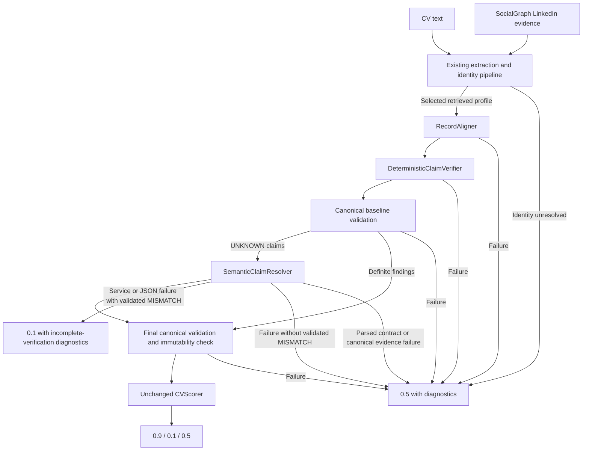

# PR24 hybrid production integration: acceptance failed

**Recommendation: keep this PR unmerged and retain the previous production path.** The hybrid candidate preserved all 23 binary classifications on the 25 saved PR18 controls, but introduced claim regressions in `fabricated_employer` and `additional_fabricated_job`. Target accuracy fell from 34/35 to 31/35. This fails the brief's requirement for no unreviewed controlled regression. Further paid evaluation and tuning stopped; none of the three planned public PDF runs was started.

## Composition and compatibility

The branch starts from merged PR22, `27267d7de72815e1c6a39c1f5cb2efc86ad2c60e`, on `task1-scoring-integration`. PR23 is an open development experiment and is not a dependency.

`hw2.build_agent(tools)` directly constructs `HybridCVVerifier` with the existing identity pipeline, `RecordAligner`, `DeterministicClaimVerifier`, `SemanticClaimResolver`, `ClaimComparisonValidator` and `CVScorer`. No new correspondence rules, broad aligner, Facebook, gate, joint comparator, reflection or retry stage is included. The resolver receives the full validated finding catalog for atomic merging, but its model receives tasks only for UNKNOWN claim IDs. When no UNKNOWN remains, the orchestrator skips the resolver entirely.



Extraction and identity algorithms are unchanged. Extraction SDK retries changed from two to zero to satisfy the brief's explicit zero-retry requirement; both model constructors use `deepseek-v4-flash`, timeout 60 seconds and thinking disabled. Alignment and semantic inference additionally bind JSON output. `score_cvs`, its three-CV semaphore, 180-second per-CV timeout, checkpoint writer, thresholds and all supplied runner code remain unchanged. The old verifier/comparator/reflector implementations and reference evaluation harnesses are retained. Inspection scripts recognize the new components; their legacy comparator/reflection instrumentation remains available. Comparator shadow inspection explicitly skips when that reference baseline is absent, rather than labelling hybrid findings as comparator output.

## Failure policy checked against HW2.pdf

The assignment requires a numeric score per CV, failure isolation and the threshold at 0.5. Its implementation/evaluation requirements do not mandate 0.5 for every processing failure. The user's conditional policy is implemented without modifying `CVScorer`:

| Failure | Score and diagnostics |
|---|---|
| Semantic service/model failure or unparseable JSON after a canonically validated deterministic MISMATCH | 0.1; baseline findings retained; `verification_complete=false`; `discrepancy_with_semantic_failure`; error retained. |
| Same semantic failure without validated MISMATCH | 0.5; incomplete verification and explicit error. |
| Deterministic verification failure | 0.5; incomplete verification; semantic stage skipped. |
| Parsed output contract or canonical evidence validation failure, including semantic correspondence violations or an attempted definite-finding override | 0.5 even if a prior MISMATCH was retained diagnostically. |

Valid workflow completion uses `verification_complete=true`; this does not imply every claim is decidable. `unresolved_evidence` distinguishes a completed UNKNOWN-based 0.5 from a processing fallback. The unchanged outer runner still returns 0.5 for a whole-CV timeout or uncaught exception. No failed model response is repaired or retried. A final review added a malformed-JSON boundary test and corrected its failure classification; the paid runs had no failures, so their outputs are unaffected.

## Paired saved-input evaluation

The existing `CVVerifier` comparator/reflection path was captured first, followed by the actual `hw2.build_agent` hybrid construction. Only the identity dependency was substituted with the identical saved extracted claims and selected profile on both paths. All hybrid verification dependencies and model calls were real. Independent expected labels, claim statuses, correspondence indexes and collection-completeness declarations were used only by the grader, never supplied as model answers.

The 25 controls derive from three public identities and include 23 binary-labelled cases and two uncertainty cases. They are correlated controls, not an unseen-set accuracy estimate. Saved-input hash: `20d673be7bff7cbe7ce58d1023d67ecdb71fcc391fbdfbee1be9ed4587f2adcf`.

| Measure | Reference | Production-wired hybrid |
|---|---:|---:|
| Binary accuracy | 23/23 | 23/23 |
| False-valid / false-discrepant predictions | 0 / 0 | 0 / 0 |
| Claim status accuracy | 444/446 (99.6%) | 439/446 (98.4%) |
| Target status accuracy | 34/35 (97.1%) | 31/35 (88.6%) |
| Independently grounded correct claims | 443/446 | 439/446 |
| Independently grounded correct targets | 34/35 | 31/35 |
| Unsafe definite findings | 2 | 3 |
| Off-anchor indexed citations | 1 | 3 |
| Wrong non-null alignments / alignment abstentions | 0 / 0 | 0 / 1 |
| UNKNOWN claims / cases containing UNKNOWN | 5 / 3 | 8 / 3 |
| Score 0.5 cases | 3 | 2 |
| Expected-negative cases with a grounded MISMATCH and score 0.1 | 10/11 | 11/11 |
| Expected uncertainty cases correctly retained | 2/2 | 2/2 |
| Processing fallbacks / invalid outputs / model errors | 0 / 0 / 0 | 0 / 0 / 0 |

A negative threshold prediction at 0.5 is **not** counted as a verified discrepancy. In the reference `fabricated_skill` case, Docker remained UNKNOWN and scored 0.5; the hybrid resolved it to MISMATCH and scored 0.1. Grounding checks cover expected status, permitted source fields, fixture correspondence and fixture-declared complete collections; they do not establish real-world completeness. The grader accepts same-record terminal-year corroboration of currentness and mixed whole-list/indexed skill citations. Those grading corrections were applied offline to both saved outputs; no model reruns occurred.

Observed regressions:

- `fabricated_employer`: the CV's substituted Siemens employer led the aligner to return null for the otherwise identifiable Deloitte record. The reference already misjudged the Senior Manager title; the hybrid additionally labelled the unchanged 2020 start year and currentness MISMATCH. All three hybrid findings are unsafe. The CV remains correctly negative because its employer is fabricated; that binary result conceals the attribute errors.
- `additional_fabricated_job`: the extra Siemens Engineer record remains null. The hybrid correctly rejects its employer but leaves title, start year, end year and currentness UNKNOWN. The complete-history fixture expects MISMATCH for all four. The reference resolved them as discrepancies, so this is a four-target regression despite the unchanged 0.1 CV score.

The reference also had an off-record Deloitte employer MATCH citation in `fabricated_skill`. The hybrid removed that citation error and recovered Docker. These improvements do not erase the regressions or satisfy acceptance.

## Runtime and usage

Both phases used thinking disabled, JSON output, zero retries, concurrency three and the existing 180-second per-case bound. Saved-input phases made **zero MCP calls** because profiles were reused.

| Measure | Reference | Hybrid |
|---|---:|---:|
| LLM calls | 38: 25 comparison + 13 reflection | 50: 25 alignment + 25 semantic |
| Input / output tokens | 94,693 / 21,047 | 52,282 / 5,608 |
| Total reported tokens | 115,740 | 57,890 |
| Missing usage reports | 0 | 0 |
| Wall time | 31.18 s | 21.12 s |
| Summed per-case runtime | 87.29 s | 58.15 s |
| Median / maximum per-case runtime | 3.51 / 4.38 s | 2.23 / 3.68 s |
| Summed model-call latency | 87.17 s | 57.92 s |

The hybrid used 12 more model calls but approximately half the tokens and lower latency in this one paired run. This establishes no full-PDF runtime result or private-set generalization. There were no timeouts. Actual extraction, MCP identity selection, public predictions, public per-CV timings and assignment-wide execution-limit compliance remain unvalidated because the controlled regression gate stopped the planned three public runs. A fake-dependency test executes the actual `hw2.run` → `score_cvs` → checkpoint/final CSV path; it is a boundary test, not a public accuracy result.

## Retained PR20 risk and rollback

The saved PR20 injection run recorded 14/18 unsafe targets after deliberately swapping two confident employment correspondences, including eight incorrect immutable deterministic findings. Deloitte/Carousell contributed 8/9 unsafe targets; Shopee/Innovate HK Ltd contributed 6/9. Null employment/education alignments recovered 25/33 targets through semantic reasoning. These are prior observations from the retained injection fixtures and ignored `pr20_injection_pair.json`, not new PR24 inference results.

This candidate uses the same record verifier and resolver, preserves alignments unchanged, and makes definite deterministic findings immutable. Canonical paths and valid indexes establish source provenance, not correct correspondence. It therefore retains the mechanism behind those failures; this PR neither measures a new injected-error rate nor claims to fix it. New controlled outputs also show that null correspondence does not guarantee safe attribute reasoning. No aligner or resolver prompt was tuned after either observation.

Acceptance: deterministic tests pass; no observed processing or output-contract failures; supplied runner and scorer unchanged; no saved-input latency regression. **Controlled claim/target regression fails acceptance; public acceptance is untested.** Do not finalize or merge this architecture on the current evidence.

Rollback before merge is to leave `task1-scoring-integration` at the existing comparator/reflection composition. If the PR is merged later, revert its integration commit; old components remain present. Packaging and Task2 are outside this PR.

Reproduction commands (paid calls; raw outputs remain ignored):

```bash
.venv/bin/python -m evaluation.run_integration --reference --output evaluation/results/pr24_reference.json
.venv/bin/python -m evaluation.run_integration --baseline evaluation/results/pr24_reference.json --output evaluation/results/pr24_integrated.json
.venv/bin/python -m unittest discover -s test
.venv/bin/python -m unittest discover -s evaluation -p 'test_*.py'
```

Validation: 318 deterministic tests passed (253 component/runner tests and 65 evaluation tests). Protected runner SHA-256 remains `4b8b874090e522ed848750ba8c2292d97701bf4a9a7f8bd9a4cf67a716b43292`. Full prompts, source records, outputs, errors and usage are stored locally in ignored `evaluation/results/pr24_reference.json` and `pr24_integrated.json`.
