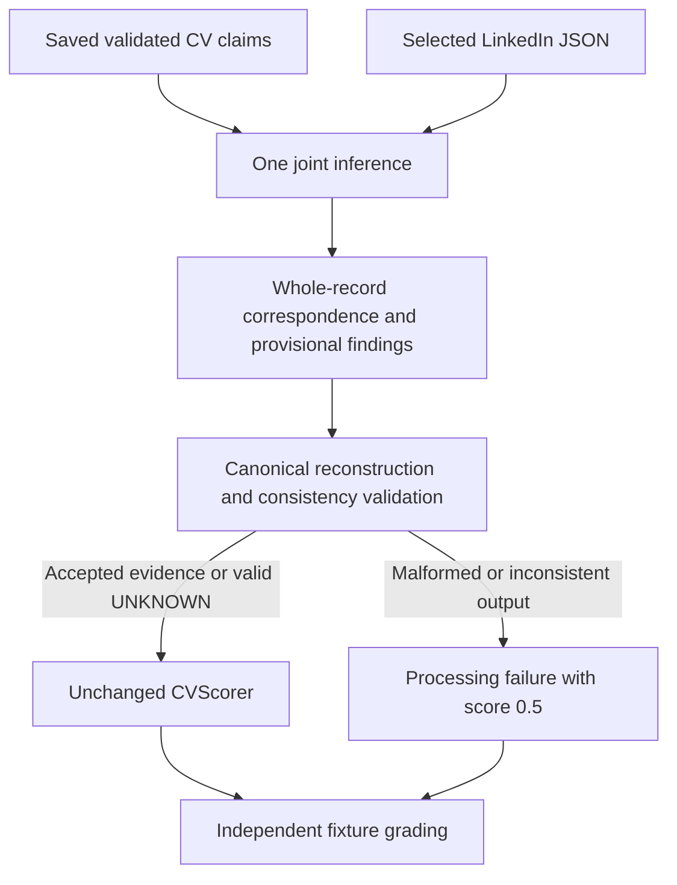

# Joint record comparator experiment (PR #23)

**Recommendation: outcome 1 — retain the production comparator.** Explicit joint correspondence improves inspection and permits narrow consistency checks, but this bounded experiment does not justify replacement. Production classified 23/23 labelled controls correctly; the joint path achieved 20/23 during the live full run and 21/23 when the same responses were replayed through the corrected final validator. The joint path still accepted a false PhD/MBA equivalence and produced a false-discrepant valid CV. Keep all new classes and tooling development-only.

## Scope and contract

Baseline: PR #22 merged into `task1-scoring-integration` as `27267d7de72815e1c6a39c1f5cb2efc86ad2c60e`. The assignment, production comparison/validation/reflection/scoring, PR18 harness and PR20 injection results were inspected. The independent architecture review was available in the conversation. LinkedIn is the assignment's primary source; Facebook agrees with it. No production file changes are included.

`JointRecordComparator.compare(claims, profile)` makes one model call. Its human context contains exactly the same claims, canonical catalog and filtered LinkedIn profile as the production comparator. The prompt reuses production's comparison rules and adds a compact joint envelope. Python owns scores, claim values and evidence values.

The output has exactly `records` and `findings`. For each CV job/education record, correspondence contains `cv_index`, `profile_index`, `state` and a concise `reason`. States are:

- `ALIGNED`: an existing indexed whole-record correspondence. All its field citations stay on that record and use relevant fields. Profile indexes need not be unique: supported overlapping/consolidated records may share an index.
- `UNRESOLVED`: null index; all its findings must be UNKNOWN. This is valid evidence uncertainty, not malformed output.
- `ABSENT`: null index, an available authoritative full collection, and collection-level evidence for MISMATCH. Missing/null collections cannot establish absence. This state remains a fallible model absence judgment, not proof that Python independently searched all aliases.

Findings retain the existing `claim_id/status/evidence_paths/reason` schema. `JointComparisonValidator.validate(output, claims, profile)` reuses canonical reconstruction, complete claim coverage and existing positive city adjudication, then checks correspondence bounds/coverage, field relevance, same-record citations, typed year/currentness consistency and explicit title/seniority consistency. An unqualified title and a separate seniority claim are independently judged; an explicit title qualifier can require both title and grade evidence. Relevant full-skills collection citations remain permitted. UNKNOWN is not mechanically promoted. Contract failures are atomic and explicit; no output repair, alternative assignment or automatic factual override occurs.

## Method and version accounting

The existing 25 PR18 controls reuse three identities: 12 valid, 11 discrepant and two uncertainty controls. The first three are MBA alias, false start year and fabricated employer. A uses unchanged production `CVVerifier`, comparator, validation, reflection and scorer with a saved resolved identity. B uses only the joint comparator/validator and existing scorer; it has no reflection. Both use `deepseek-v4-flash`, thinking disabled, JSON-object output, zero retries, concurrency three and the existing timeout. Pair order alternates. There is no extraction, discovery, alignment inference, semantic recovery, MCP retrieval or response replay during the paid pair.

Offline assertions verified byte-for-byte equivalent decoded comparison contexts for all 25 pairs and absence of grading fields from all model contexts. Case SHA-256 is `20d673be7bff7cbe7ce58d1023d67ecdb71fcc391fbdfbee1be9ed4587f2adcf`, matching freshly loaded PR18 fixtures. Inputs/expectations remain unchanged.

The three-case live slice initially rejected all B outputs: an incorrect typed date MATCH, an UNRESOLVED/non-null correspondence, and a valid full-skills MATCH citation rejected by an unnecessarily narrow new check. The skills check was corrected before the full run; saved slice responses were validated offline, accepting the alias case and continuing to reject the other two. No prompt change or repeated paid slice occurred.

The single full paired run initially had four B contract failures. Review found one validator bug: it borrowed a separately claimed seniority into an unqualified title finding and demanded a redundant grade citation. That claim-scope check was corrected, with a regression test. The final contract was then applied offline to every unchanged saved B response, preserving the original live artifact. This accepts the previously rejected valid title-plus-seniority case. The final replay is a deterministic analysis of the same 25 sampled responses, not a second live run or independent sample. No prompt tuning, further model calls, or silent repair of model outputs occurred.

## Results

| Metric | Production live | Joint live | Joint final-contract replay |
|---|---:|---:|---:|
| Binary accuracy | 23/23 | 20/23 | 21/23 |
| False-valid / false-discrepant | 0 / 0 | 1 / 2 | 1 / 1 |
| Target status accuracy | 34/35 (97.1%) | 29/35 (82.9%) | 31/35 (88.6%) |
| Grounded target accuracy | 34/35 | 29/35 | 31/35 |
| Grounded full-catalog accuracy | 428/446 (96.0%) | 372/446 (83.4%) | 391/446 (87.7%) |
| Grounded definite findings | 424 | 368 | 387 |
| Correct UNKNOWN abstentions | 4 | 4 | 4 |
| Unsafe accepted definite findings | 0 | 1 | 1 |
| Contract-failure cases | 1/25 | 4/25 | 3/25 |
| Score-0.5 cases / processing fallbacks | 3 / 1 | 6 / 4 | 5 / 3 |
| Verified expected-discrepancy cases | 10 | 8 | 8 |
| Unverified expected-discrepancy claims | 1 | 3 | 3 |
| Correct uncertainty controls | 2/2 | 2/2 | 2/2 |

Grounding requires the expected status, relevant canonical evidence and the independently expected record index, or explicitly declared complete-collection absence evidence. Complete-list enumeration can justify absence without being mislabelled as a wrong alignment. Correct UNKNOWNs are reported separately from definite findings. Missing findings after atomic rejection stay in the denominator as processing failures, not UNKNOWNs. The 446-claim metric is secondary: untouched-field expectations propagate from source controls and are less decisive than the 35 predefined targets after parent-record mutations.

### Observed fixes, failures and correspondence

There were **no target or binary fixes of production errors**, under either full-run contract. Both paths failed `fabricated_employer`: production cited a null employment end year; B proposed UNRESOLVED with a non-null index. Their 0.5 scores classify this negative CV correctly but verify no employer discrepancy.

- `start_year_contradiction`: production verified 2021 versus LinkedIn 2020. The full B response also contained the correct indexed MISMATCH but added an unexpected top-level `type` key, so the entire output was rejected. Its 0.5 label is not verified discrepancy detection. The preliminary slice instead returned an actual incorrect date MATCH, caught by typed consistency.
- `title_plus_seniority_equivalence`: the original full-run failure was the validator claim-scope bug described above. Final offline validation accepts all 19 findings and scores 0.9; this is correction of our implementation, not a new model success.
- `unqualified_title_extra_grade`: B swapped both job indexes and described BCG facts as though they were on Tencent's index. It also cited a null end year. Canonical validation rejected it, leaving a valid CV at 0.5. The original response is retained; Python does not repair indexes or citations.
- `fabricated_degree`: B correctly chose Stanford's record but called PhD compatible with its canonical degree `MBA`, producing MATCH and score 0.9. The validator establishes provenance and consistency, not semantic degree equivalence, so this error passes. Production reflection corrected its own initial degree MATCH to MISMATCH. Reflection also corrected production's initial seniority MATCH in `explicit_seniority_contradiction`; B handled that latter case correctly without reflection.

Raw B proposals cover 75 records: 71 correct correspondences, two incorrect indexed assignments, one malformed UNRESOLVED/non-null proposal and one correct ambiguous correspondence. States were 72 ALIGNED, two UNRESOLVED and one ABSENT. Under the final contract, accepted outputs contain 64 correct ALIGNED records, one correct ABSENT record and one valid UNRESOLVED record; all observed wrong assigned indexes were in rejected outputs. These are correlated fixture counts, not independent reliability estimates.

**Coherent wrong correspondence can still pass.** A deterministic contract test deliberately swaps both jobs of a valid saved CV, cites each wrong mapped record consistently and gives scalar judgments consistent with those wrong records, leaving the unavailable end-year claim UNKNOWN. Validation accepts this internally coherent output and the scorer returns 0.1. This is a constructed fake-output stress test, not an observed live model outcome. Neither an in-range index nor a consistent typed comparison proves semantic correspondence. False ABSENT assertions likewise remain a semantic risk.

## Calls, tokens and latency

The full run made 39 A calls (25 comparison, 14 reflection) and 25 B calls. A reported 97,972 input / 21,248 output / 119,220 total tokens; B reported 60,321 / 25,512 / 85,833. All calls reported usage. Summed call latency was 89.99 seconds A versus 90.72 seconds B; paired wall time was 65.79 seconds. Fewer B calls/tokens did not improve measured summed latency. These exclude extraction and identity costs, and token volume is not a billing estimate. Final replay adds zero model calls and does not establish a new runtime measurement.

The preliminary slice made four A and three B calls, totaling 22,499 tokens and 7.86 seconds wall time. Across the slice and full run: **71 actual model calls, 227,552 reported tokens, zero MCP calls, zero retries, zero transport failures/timeouts**. The prompt remained unchanged throughout; only the two deterministic contract bugs were corrected, with saved-response replay and no extra inference.

Raw ignored artifacts: `evaluation/results/pr23_joint_slice.json`, `pr23_slice_contract_replay.json`, `pr23_joint_pair.json` and `pr23_final_contract_replay.json`. Full live artifact SHA-256: `dbb85c6eda53d1877916c620cabb445d1e3ec2e1032469a8eba0443972beb0a5`; final replay SHA-256: `b42a36cd49868a1acdbeeef90cb63fd8c7764a0e79b0e230a95d59df24e92c85`.

## Recommendation and validation

Retain production. The joint contract provides clearer correspondence diagnostics and catches some inconsistent outputs, but still admits semantic mistakes and pays for strict atomic rejection with lost valid findings. The comparison also changes prompt length and omits production's positive reflection, so it cannot attribute all differences solely to explicit correspondence. The tested implementation is not proof that every joint architecture is inferior; it is insufficient evidence for replacement. Stop this bounded experiment rather than tune it repeatedly on the same identities.

Reproduce a future bounded run with `python -m evaluation.run_joint --limit 3`, or omit `--limit` for the 25 controls. Results are restricted to ignored `evaluation/results/`. Run deterministic tests with `python -m unittest discover -s test` and `python -m unittest discover -s evaluation`. Validation: 328 tests passed (242 component, 62 prior evaluation and 24 new joint tests), including false attributes, aliases, reordering, shared indexes, ambiguity, absent records, evidence relevance, malformed/incomplete output, canonical provenance, coherent wrong mapping, input isolation, failure isolation, no retries and bounded concurrency. Production code, scoring, timeouts, concurrency, checkpoints and the supplied runner are unchanged.
