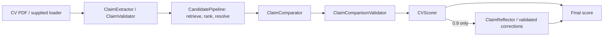
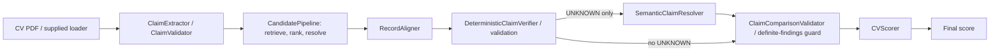

# Production versus hybrid: contemporaneous reliability evaluation

**Recommendation: option 3 — evidence is inconclusive; retain the existing production comparator for delivery-risk reasons.** Both full pipelines classified all 21 contemporaneous public decisions correctly. Hybrid reduced observed token use and latency, but its fixed-input evidence coverage was slightly lower and two structured alignment contract failures erased findings. This sample does not justify a submission architecture change. No implementation was promoted or modified.

## Exact sources and fairness

Architecture A is PR #25 head `8f26dd98702393bea8c650e764e16d1a7e861211` (`final-production-consolidation`, still open). Architecture B is closed/unmerged PR #24 head `82ccb4bac6611deddc14abb1e68d20fb46ff0815` (`hybrid-production-integration`). PR #26 is stacked on PR #25; it does not merge #24. Source snapshots came directly from these Git objects into ignored artifact folders. Before/after SHA256 manifests verify unchanged `hw2.py`, every verifier module, requirements and public inputs. Protected runner sections and all seven PDF bytes also match starter `7e9cf75`.

All eight extraction/identity component modules, the comparison validator and scorer match between revisions (experimental module relocation changes imports only). **One native configuration difference is preserved: extraction SDK `max_retries=2` for production versus `0` for hybrid.** All other model calls have zero configured retries. Callbacks observe logical LLM calls; successful hidden SDK retries cannot be counted separately, so the full-pipeline retry confound is not assumed away. Fixed/structured experiments bypass extraction and eliminate it.

Both paths ran through the same Python executable and installed environment, `deepseek-v4-flash`, thinking disabled, SocialGraph MCP, JSON verification configuration, 60-second model request timeouts, three-CV concurrency, 180-second per-CV timeout, score threshold `>0.5`, and identical discovery/retrieval budgets (eight profile attempts). Native prompts, validators, search and scoring were untouched. No Facebook, gates, retries, fallback agents or synthetic PDFs were introduced.

Observed environment: Python 3.14.0; LangChain 1.4.4, langchain-core 1.6.9, langchain-deepseek 1.1.1, langchain-mcp-adapters 0.3.2, markitdown 0.1.8 and OpenAI transport SDK 3.29.0. Complete installed versions are in the ignored manifest.

## Actual chains





The candidate pipeline in each chain uses the same ProfileRetriever, CandidatePrioritizer, CandidateRankingValidator, IdentityResolver and IdentityDecisionValidator. The native hybrid also preserves validated deterministic discrepancies on service/JSON failures during semantic resolution, while parsed contract failures fall back as implemented in #24; no such semantic service failure occurred here.

## Comparison table

| Metric | Production | Hybrid |
|---|---:|---:|
| Full public run 1 | 7/7; 42.53s | 7/7; 36.23s |
| Full public run 2 | 7/7; 40.96s | 7/7; 39.53s |
| Full public run 3 | 7/7; 45.32s | 7/7; 33.52s |
| Total correct / 21 | 21/21 | 21/21 |
| False-valid classifications | 0 | 0 |
| False-discrepant classifications | 0 | 0 |
| Wrong identities | 0 | 0 |
| Unresolved identities | 0 | 0 |
| Processing/contract failure cases | 0 | 0 |
| Grounded MISMATCH outcomes | 9 | 9 |
| UNKNOWN/0.5 fallbacks | 0 | 0 |
| LLM calls (full pipelines) | 99 | 100 |
| Tokens (full pipelines) | 245,635 | 171,826 |
| Wall runtime, three full runs | 128.81s | 109.29s |
| Fixed-upstream binary accuracy | 21/21 | 21/21 |
| Fixed-upstream target claim accuracy | 9/9 | 8/9 |
| Fixed-upstream grounded claim accuracy | 384/384 | 383/384 |
| Extended 25-case binary accuracy | 23/23 | 23/23 |
| Extended 25-case target claim accuracy | 34/35 | 33/35 |
| Extended 25-case grounded claim accuracy | 442/446 | 413/446 |

The historical #25 public results (6/7, 7/7, 6/7) are reference observations only and are not included in these denominators. The six new runs used order **A1, B1, B2, A2, A3, B3** to alternate which path runs first. There were no failed or discarded runs. All six executions delegated to the actual frozen `hw2.main()`/`run()`/`build_agent()`/`score_cvs()` and protected final CSV writer using PR #25's common diagnostic wrapper. Each produced exactly seven data rows and seven checkpoints. Maximum verification time was 18.67s; every run was below 30 minutes.

## Experiment A: each original seven-CV invocation

Each cell is **selected LinkedIn ID / score / per-CV verification seconds**. Scores 0.9 classify valid (1); 0.1 classify discrepant (0). Every negative below had a validated MISMATCH against the audited correct identity; there were no UNKNOWN-only negatives or processing fallbacks. All 42 extractions passed validation, though one omitted a field as described below. Shortlists, attempted IDs, extraction output, upstream profiles, findings/citations and stage/model timings are retained in the ignored raw records.

### Full run 1

| CV | Production | Hybrid |
|---|---|---|
| CV_1.pdf | 6337 / 0.9 / 13.64s | 6337 / 0.9 / 11.29s |
| CV_2.pdf | 47 / 0.9 / 13.36s | 47 / 0.9 / 12.31s |
| CV_3.pdf | 6541 / 0.9 / 13.37s | 6541 / 0.9 / 11.18s |
| CV_4.pdf | 8235 / 0.1 / 15.43s | 8235 / 0.1 / 14.01s |
| CV_5.pdf | 1297 / 0.1 / 17.08s | 1297 / 0.1 / 12.74s |
| CV_6.pdf | 6561 / 0.9 / 17.62s | 6561 / 0.9 / 13.72s |
| CV_7.pdf | 9590 / 0.1 / 12.63s | 9590 / 0.1 / 11.22s |

### Full run 2

| CV | Production | Hybrid |
|---|---|---|
| CV_1.pdf | 6337 / 0.9 / 15.05s | 6337 / 0.9 / 11.28s |
| CV_2.pdf | 47 / 0.9 / 15.51s | 47 / 0.9 / 11.93s |
| CV_3.pdf | 6541 / 0.9 / 14.47s | 6541 / 0.9 / 11.42s |
| CV_4.pdf | 8235 / 0.1 / 11.85s | 8235 / 0.1 / 14.68s |
| CV_5.pdf | 1297 / 0.1 / 12.88s | 1297 / 0.1 / 13.49s |
| CV_6.pdf | 6561 / 0.9 / 13.49s | 6561 / 0.9 / 18.67s |
| CV_7.pdf | 9590 / 0.1 / 13.58s | 9590 / 0.1 / 13.02s |

### Full run 3

| CV | Production | Hybrid |
|---|---|---|
| CV_1.pdf | 6337 / 0.9 / 15.32s | 6337 / 0.9 / 11.29s |
| CV_2.pdf | 47 / 0.9 / 16.92s | 47 / 0.9 / 12.33s |
| CV_3.pdf | 6541 / 0.9 / 16.51s | 6541 / 0.9 / 12.01s |
| CV_4.pdf | 8235 / 0.1 / 16.75s | 8235 / 0.1 / 9.60s |
| CV_5.pdf | 1297 / 0.1 / 17.32s | 1297 / 0.1 / 9.89s |
| CV_6.pdf | 6561 / 0.9 / 17.23s | 6561 / 0.9 / 11.03s |
| CV_7.pdf | 9590 / 0.1 / 12.18s | 9590 / 0.1 / 11.50s |

There was no full-run binary, identity or claim-status disagreement on mutually extracted claims. Production run 2 CV_2 returned `education.0.school=null`; the other five runs extracted the school. Its BSc/Design/2011 facts still identify the single HKU education record, but the school claim was absent from the production catalog. Full-pipeline claim accuracy is therefore **383/383 extracted claims versus 384/384**, conditional on extraction coverage, not proof that every PDF assertion was checked. The omitted school was not repaired or injected into either verifier.

Production's comparator initially missed CV_5's explicit Senior Analyst versus Analyst/junior contradiction in all three full runs. Its existing reflector corrected `jobs.1.title` to MISMATCH using `experience.1.title` and `experience.1.seniority` each time, producing the correct final 0.1. The same correction occurred in all three fixed-input rounds. Hybrid established that contradiction through deterministic title/seniority verification. The public tie depends on assessing the complete comparator/reflection architecture.

## Experiment B: fixed upstream, three rounds

The preregistered selection rule retained the first chronological capture of each distinct (CV, selected ID), without inspecting scores/labels. All six full runs resolved the same audited identities, so this yielded seven complete upstream snapshots from A1. There were **no naturally incorrect or unresolved identities** to include; none was manufactured. The runner supports unresolved inputs as recorded skips, tested deterministically, but that condition was not exercised by live Experiment B. This limits causal conclusions about the upstream failures seen historically.

Each architecture received fresh deep copies of the same validated claims and profiles, with input SHA256 equality checked across all three rounds and no mutation allowed. The actual #25 CVVerifier and #24 HybridCVVerifier were built through their native construction functions; only the out-of-scope identity dependency returned the captured upstream object. All verification LLM calls were real, not mocks.

| Metric, all 21 fixed-input decisions | Production | Hybrid |
|---|---:|---:|
| Binary correct | 21 | 21 |
| False valid | 0 | 0 |
| False discrepant | 0 | 0 |
| Grounded MISMATCH outcomes | 9 | 8 |
| 0.5 negative fallbacks | 0 | 1 |
| UNKNOWN findings | 0 | 1 |
| Processing failures | 0 | 0 |
| Wrong-record citations | 0 | 0 |
| LLM calls | 36 | 36 |
| Input tokens | 93,356 | 33,408 |
| Output tokens | 17,954 | 3,523 |
| Total tokens | 111,310 | 36,931 |
| Wall runtime across three rounds | 31.65s | 15.54s |
| Full-catalog / grounded claims | 384/384 | 383/384 |

Round scores, in CV_1…CV_7 order:

| Round | Production | Hybrid |
|---|---|---|
| 1 | 0.9, 0.9, 0.9, 0.1, 0.1, 0.9, 0.1 | 0.9, 0.9, 0.9, 0.1, 0.1, 0.9, 0.1 |
| 2 | 0.9, 0.9, 0.9, 0.1, 0.1, 0.9, 0.1 | 0.9, 0.9, 0.9, 0.1, 0.1, 0.9, 0.1 |
| 3 | 0.9, 0.9, 0.9, 0.1, 0.1, 0.9, 0.1 | 0.9, 0.9, 0.9, 0.1, 0.1, 0.9, 0.5 |

**Only claim-status disagreement:** hybrid round 3 CV_7 kept `skills.0.name` (Docker) UNKNOWN because the semantic response declined to treat the supplied skills list as exhaustive. It cited `skills` containing Python, Go, Kubernetes and Java. Production returned MISMATCH with that collection in all three rounds; hybrid did so in rounds 1 and 2. The hybrid result was `unresolved_evidence`, score 0.5, no processing error. Both classify the CV negative, but only the 0.1 outcomes verify the expected discrepancy. Identical upstream hashes isolate this difference to semantic verification/model variation, not identity or extraction.

## Extended PR #18 controls: all 25 cases

Both native verifiers received the same saved claims and selected profiles for all 25 cases, including two uncertainty controls; no case was dropped. One contemporaneous run per architecture was performed. The historical approximate hybrid helper was not used. The same existing PR #18 status/target grader and the stricter PR #24 evidence-grounding grader were applied to both paths offline. The 446-claim denominator includes unaffected claims; 35 targets focus on designated mutations/controls. Grading also checks record anchors, relevant fields and justified complete-collection absence.

| Metric | Production | Hybrid |
|---|---:|---:|
| False valid | 0 | 0 |
| False discrepant | 0 | 0 |
| Grounded MISMATCH outcomes | 10 | 10 |
| 0.5 on known-label cases | 1 | 1 |
| 0.5 including uncertainty controls | 3 | 3 |
| UNKNOWN findings | 5 | 3 |
| Processing/contract failure cases | 1 | 2 |
| Model/service failures | 0 | 0 |
| Wrong-record citations | 0 | 0 |
| Off-anchor citations | 0 | 0 |
| Correspondence errors | 0 | 0 |
| Correspondence abstentions | 0 | 1 |
| LLM calls | 38 | 48 |
| Input tokens | 94,522 | 49,082 |
| Output tokens | 20,986 | 5,200 |
| Total tokens | 115,508 | 54,282 |
| Full-catalog claim accuracy | 442/446 | 413/446 |
| Clean genuine-uncertainty controls | 2/2 | 1/2 |
| Wall runtime | 33.28s | 19.64s |

Missing findings from a failed stage are errors in the full-catalog denominator, not UNKNOWN findings. Hybrid's smaller UNKNOWN count therefore does not indicate better coverage: its two alignment failures omitted 33 findings.

### Stage-level disagreements and failures

- **Fabricated employer:** both correctly score 0.1. Production also marks the unchanged title, start year and current-employment claims MISMATCH, citing the whole experience collection because no Siemens role exists. The controlled catalog expects these three fields to remain MATCH against the Deloitte record identified by the remaining context. Hybrid anchors to `experience.1`, mismatches the company and preserves those three definite matches. This is a correspondence/claim-semantics disagreement under the declared evaluation gold, not a wrong indexed-record citation.
- **Fabricated skill:** production leaves Docker UNKNOWN (0.5, no processing error); hybrid verifies its absence as MISMATCH (0.1). Correct negative classification is shared; verified discrepancy coverage differs.
- **Fabricated school:** production verifies MISMATCH (0.1). Hybrid alignment output returns `education: []` for a CV containing one education record; the unchanged validator raises `Missing CV record alignments`, leaving no findings and score 0.5. Its correct negative is a processing fallback.
- **Ambiguous record details:** production preserves the intended UNKNOWN record finding and other claims. Hybrid invents an extra `cv_index: 2` where the CV has only indexes 0 and 1; alignment validation raises `CV record index must be an in-range integer`, leaving no findings at 0.5. The binary score resembles uncertainty but the uncertainty-control contract failed.
- **BSc alias:** production reflection proposes an unsupported title/seniority correction; validation rejects it with `Reflection must contradict the claimed title or explicit seniority`, preserving the correct 0.9 baseline. This is one nonfatal contract failure, distinct from hybrid's two fatal-to-findings alignment failures.
- **Fabricated degree:** hybrid abstains from education correspondence (one expected anchor missed), then semantic resolution correctly establishes the degree discrepancy. No wrong-record citation or incorrect non-null correspondence was observed in either architecture in this evaluation. This does not estimate their rate on unseen CVs.

All other structured target decisions agree. Every disagreement above is retained in `analysis.json` with original responses, findings, evidence paths, errors, timings and grading. One structured run per architecture cannot establish failure frequency. PR #20's injected alignment failures describe vulnerability severity, not naturally occurring error rates here.

## Cost, latency and interpretation

Hybrid used about **30.0% fewer total tokens** over full pipelines, **66.8% fewer** on fixed-input verification and **53.0% fewer** on the 25 controls. Fixed-input LLM call count was identical (36 per architecture); smaller verification contexts/outputs account for the observed token reduction. Across three full runs, average wall runtime was 42.94s production versus 36.43s hybrid; fixed-input totals were 31.65s versus 15.54s. These are measured token/latency costs, not monetary estimates; cache state, provider load and sequential execution affect timing.

**Observed:** a public classification tie; lower hybrid token/latency costs; one fixed-input hybrid abstention; better hybrid handling of one employer mutation and one skill mutation; higher hybrid structured contract-failure impact. **Interpretation:** the accuracy evidence is mixed and too small/correlated to establish unseen-set superiority. Shared upstream nondeterminism remains relevant despite its absence in these six runs. The existing production path is retained to avoid an unproven delivery change, not because elegance or prior investment establishes grading accuracy.

## Reproduction, artifacts and checks

From a fresh checkout of this PR with the same dependencies and an API key in the environment/ignored `.env`:

```bash
git fetch origin final-production-consolidation hybrid-production-integration
.venv/bin/python -m evaluation.reliability prepare
.venv/bin/python -m evaluation.reliability full
.venv/bin/python -m evaluation.reliability select
.venv/bin/python -m evaluation.reliability fixed
.venv/bin/python -m evaluation.reliability extended
# After independently auditing captured public identities/correspondences:
.venv/bin/python -m evaluation.reliability_report
.venv/bin/python -m unittest discover -s test -q
.venv/bin/python -m unittest discover -s evaluation -q
```

Raw results are deliberately **not committed**, as requested. They remain at `evaluation/results/pr26/`: `manifest.json`, six `full_*.json` plus CSVs/logs, `fixed_inputs.json`, six `fixed_*.json`, two `extended_*.json`, `public_audit.json` and derived `analysis.json`. Native source snapshots and complete prompt/response/usage traces remain there too. The files contain no configured API key. Capture commands refuse overwrite; preserve existing artifacts and use a fresh checkout for an independent repeat. Repeated live results are stochastic, not byte-identical expectations.

`public_audit.json` is a manual, offline reference: the distinctive employer pairs, education and locations in A1 were checked against the selected SocialGraph profiles, then supplied public discrepancy reasons defined the three target fields. It records the one reviewed missing-school correspondence separately. Those annotations and all expected statuses/completeness/anchors are used only after verification. The offline report requires this audit artifact; on a new live capture, audit identities and claims independently before creating it rather than assuming the first selected profile is correct. The retained audit plus raw captures reproduce this report's metrics without additional model calls.

No expected-label/target/completeness/anchor metadata appeared in any of the **315 captured structured human messages**; the other 42 LLM calls used original PDF text for extraction. Both implementations' source hashes remain unchanged. **246 implementation tests plus 66 evaluation tests pass (312 total)**, including four new tests covering callback accounting, unchanged delegation/upstream copies, label-independent selection with unresolved cases, and fallback-versus-verified-discrepancy metrics. Aggregate freshness and `git diff --check` pass. No GitHub Actions workflows are configured. No Task 2 or submission-source changes.

### Raw capture fingerprints

| Artifact | SHA256 | Bytes |
|---|---|---:|
| `full_production_1.json` | `ebb8180faac4341c818a6bf8131856d2da8b8c84d65230037e1fabb969abf8bc` | 808116 |
| `full_production_2.json` | `324249014c58197dc2e0735a608e9d1ab98bae3d2d1c071190c85fcf9a0282df` | 813757 |
| `full_production_3.json` | `93a5e5114f8f1241a5f16061a922ea2387e88908d8d1f4de29d80362c074d778` | 813989 |
| `full_hybrid_1.json` | `1802b79b81cfde7e62f57d86fa02ab90570ec4f4eee59441089bf74a47b23ce2` | 771582 |
| `full_hybrid_2.json` | `6fdc4e68784d6579129f5d4dd5542e05defb8ec38939df590f7472fff1fe0a60` | 786013 |
| `full_hybrid_3.json` | `c8fd220ccb0d137e61d847dce57e2811da670e3a459a8ff6dd9d05078d700a77` | 768841 |
| `fixed_production_1.json` | `f20f9d40ccfdb9ea1c6f81ec34b990a9949afb2a52c14511c73373178156e2d8` | 410923 |
| `fixed_production_2.json` | `4e8afc12813d8b463fa8b3616f69b8d9a2e096990fb4c4cf782a3a64f9027397` | 410019 |
| `fixed_production_3.json` | `31dc1153a013227a0fbcbd3b7772d7ad4306c77bd5970599567192a51affebe7` | 408521 |
| `fixed_hybrid_1.json` | `6f13a292a33085642016dfb6fa5a7bbb686ca747912b62d810267a97ef045318` | 371955 |
| `fixed_hybrid_2.json` | `d355549bc15381a4fb43ba59bbe3218fe1892c277646dacce451b2243bd6a93f` | 372277 |
| `fixed_hybrid_3.json` | `bb30ec469d570202f95ca002ff7740c78d7defcf44839a5d39c88d533c3ac194` | 372153 |
| `extended_production_1.json` | `8a44768e16a5ebe956917e2f16b6fa5ad9bad387905010906053099a6f2b92fe` | 845246 |
| `extended_hybrid_1.json` | `d46f4b0afa11854b82573c1cd8f34445f269d41b9cabee229a2502eadd04b05b` | 796774 |
