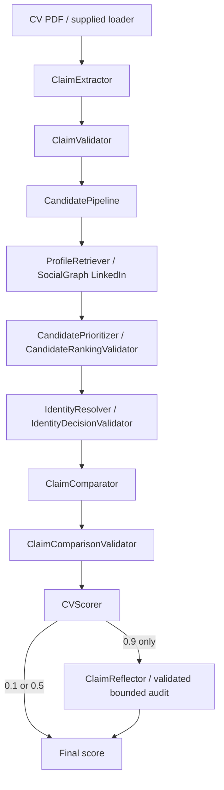

# Task 1 submission and consolidation evidence

The executable submission is **`hw2.py` plus `cv_verifier/`**. The generated
`production_source.py` is a lecturer record, not the authoritative implementation.
The assignment PDF does not prescribe an aggregate filename/format; modular code
is permitted per the lecturer confirmation supplied with this task.

## Production architecture and dependency inventory



`CVVerifier.ainvoke(cv)` is the primary orchestration method. Dependencies are
injected explicitly by `build_agent(tools)`; `score_cvs` runs at most three CVs
concurrently, applies the existing 180-second per-CV timeout, isolates failures
at 0.5, and writes atomic incremental checkpoints. The supplied runner loads
PDFs, grades and writes the final `results.csv`.

| Production module / class | Responsibility / injected collaborators |
|---|---|
| `claim_extractor` / `ClaimExtractor` | CV text → structured claims; extraction LLM |
| `claim_validator` / `ClaimValidator` | Validate extracted schema and locations |
| `profile_retriever` / `ProfileRetriever` | LinkedIn MCP search/profile retrieval; supplied tools |
| `candidate_prioritizer` / `CandidatePrioritizer` | Rank candidate investigation; LLM |
| `candidate_ranking_validator` / `CandidateRankingValidator` | Validate shortlist against search hits |
| `identity_resolver` / `IdentityResolver` | Resolve among retrieved profiles; LLM |
| `identity_decision_validator` / `IdentityDecisionValidator` | Validate candidate decision and profile IDs |
| `candidate_pipeline` / `CandidatePipeline` | Extract/validate, discover, rank, retrieve, resolve; seven collaborators above |
| `claim_comparator` / `ClaimComparator` | Semantic correspondence/comparison; LLM, canonical comparison contract |
| `claim_comparison_validator` / `ClaimComparisonValidator` | Reconstruct canonical claims/evidence, validate coverage/citations, city adjudication and reflection corrections |
| `cv_scorer` / `CVScorer` | 0.1 if any established mismatch; 0.5 if unresolved/unknown; otherwise 0.9 |
| `claim_reflector` / `ClaimReflector` | One positive-result audit; LLM, existing correction contract |
| `cv_verifier` / `CVVerifier` | Identity → comparison → validation/scoring → conditional reflection |

There are **13 production classes in 13 implementation modules**, plus empty
`__init__.py` and the `hw2.py` entry point. Production source totals **1,522 lines**
including `hw2.py`, comments and blank lines. The aggregate has **1,565 lines**.
Runtime imports from these files reach no evaluation/experimental implementation.
External libraries remain those in the unchanged `requirements.txt`.

All retained production files, including `hw2.py`, are byte-identical to baseline
`27267d7de72815e1c6a39c1f5cb2efc86ad2c60e` (PR #22, base
`task1-scoring-integration`). This preserves prompts, thinking-disabled
`deepseek-v4-flash`, existing extraction SDK retries (2), other model retries (0),
60-second request timeouts, search/retrieval limits, identity policy, validation,
reflection and scoring. No new verification stage or retry was added.

## Cleanup and recoverability

Four implementations moved from `cv_verifier/` to `evaluation/experimental/`:
`RecordAligner`, `EvidenceAligner` (with its validator),
`DeterministicClaimVerifier`, and `SemanticClaimResolver`. Only their comparison
contract import paths changed. Historical evaluation/shadow imports and tests
were updated; their behavior, fixtures and findings remain available.
`CorrespondencePlausibilityGate` stays in evaluation only. Historical adapters
remain in evaluation/development scripts, outside submission imports.

`HybridCVVerifier` and `JointRecordComparator` were never in the merged baseline:
PRs #24 and #23 were confirmed closed/unmerged. Their branches/history remain
recoverable; their code was not copied into this branch. No Facebook integration,
hybrid promotion, new agent stage, prompt redesign or Task 2 change was made.

## Extended evaluation: identical 25-case PR #18 catalog

| Metric | Baseline | Consolidated |
|---|---:|---:|
| Known-label binary accuracy | 23/23 (100%) | 23/23 (100%) |
| Target-claim accuracy | 33/35 (94.29%) | 32/35 (91.43%) |
| Full-catalog claim accuracy | 443/446 (99.33%) | 423/446 (94.84%) |
| Grounded claim accuracy | 442/446 (99.10%) | 422/446 (94.62%) |
| False-valid predictions | 0 | 0 |
| False-discrepant predictions | 0 | 0 |
| UNKNOWN findings | 6 | 8 |
| Contract / model errors | 0 / 0 | 1 / 0 |
| LLM calls | 38 | 39 |
| Input / output tokens | 94,622 / 21,030 | 97,772 / 21,135 |
| Total tokens | 115,652 | 118,907 |
| Wall runtime | 34.99s | 34.93s |
| Sum of per-case runtimes | 97.27s | 96.96s |
| Genuine uncertainty controls preserved | 2/2 | 2/2 |
| Cases with a MISMATCH finding | 9 | 9 |
| Independently grounded expected discrepancy | 8 | 8 |

Expected labels, target answers, completeness assumptions and correspondence
anchors are used only after model verification for grading. Full-catalog accuracy
uses all 446 catalog claims, including unaffected claims; target accuracy uses
35 explicitly designated claims. Grounded accuracy additionally checks indexed
record correspondence or explicitly justified collection absence using the
existing evaluation grader. Neither metric establishes semantic proof in general.

The consolidated `end_year_contradiction` response cited unavailable profile
evidence and failed the unchanged contract with “Missing profile values are not
supporting or contradictory evidence”. Its 0.5 fallback still meets the negative
binary label but **does not verify a discrepancy**. Other differences include
ambiguous fabricated-employer fields, a borrowed `is_current` citation on the
fabricated extra job, and unresolved fabricated-skill evidence. The baseline
also had an off-anchor employer citation and UNKNOWN fabricated-degree/skill
findings. These are retained model weaknesses, not tuned away.

Both live captures replay **exactly across all 25 cases** through the consolidated
modular classes and generated classes, including prompts, canonical evidence,
findings, scores and errors (100 case replays across two captures × two forms).
Production source hashes are unchanged. The independent-run differences therefore
come from model responses, not consolidation behavior. Captures are stored as
deterministic gzip JSON under `evaluation/fixtures/`; each includes prompts,
responses, usage, inputs, case hashes and grading for offline reproduction.

## Original public PDFs

Only `public_test/CV_1.pdf` through `CV_7.pdf` were used. All seven match the
original starter commit `7e9cf75` byte-for-byte; their SHA256 hashes are recorded
in [the machine-readable results](../evaluation/consolidation_results.json).
No synthetic/mutated/generated PDF was included. The wrapper calls the actual
`hw2.main()` CLI parser and supplied `run()` and delegates to the unchanged
`build_agent`, `score_cvs` and checkpoint writer. It records results without
passing labels, filenames or expected answers into verification.

Detailed public-run tables and clean-clone evidence are recorded below after
the fresh-clone invocation. Raw public diagnostics, including selected profiles,
findings/errors, reflection and final CSV rows, are preserved in compressed
fixtures; [the result summary](../evaluation/consolidation_results.json) provides
the compact per-CV view.

## Reproduce and submit

Use Python 3.10+ and an API key supplied through the environment or ignored `.env`:

```bash
python3 -m venv .venv
.venv/bin/python -m pip install -r requirements.txt
.venv/bin/python hw2.py --cv-folder public_test
.venv/bin/python -m unittest discover -s test -q
.venv/bin/python -m unittest discover -s evaluation -q
.venv/bin/python -m scripts.aggregate_source --check
# Regenerate only after changing authoritative modular source:
.venv/bin/python -m scripts.aggregate_source
# Fresh 25-case live run:
.venv/bin/python -m evaluation.run_production --output evaluation/results/production.json
# Offline captured-response parity (add --aggregate to check generated classes):
.venv/bin/python -m evaluation.run_production --replay evaluation/fixtures/production_baseline.json.gz --output evaluation/results/replay.json
# Observe the original seven-PDF supplied runner:
.venv/bin/python -m scripts.evaluate_public --output evaluation/results/public.json
```

Keep `hw2.py`, the whole `cv_verifier/` package, `requirements.txt` and report
in the submitted repository. Do not replace modular execution with the aggregate.
No key is included in artifacts. Baseline commit/branches remain recoverable;
the official base is unchanged until review and merge.

## Checks and remaining risks

- 246 implementation/submission tests and 62 historical evaluation tests pass.
  These exercise class boundaries, strict evidence handling, scoring, three-CV
  concurrency, timeout cancellation, failure isolation, incremental checkpoints,
  atomic replacement failure, final CSV and supplied runner integrity.
- Generated output is deterministic, compiles, imports without the modular
  package, contains no unresolved local import/duplicate class, matches all
  production definitions/constants by AST and embeds each source SHA256.
- `git diff --check` passes. No GitHub Actions workflow is configured in this
  repository (API workflow inventory empty), so there are no remote CI jobs to run.
- Identity selection and model contract failures can produce wrong results or
  0.5 fallbacks; binary accuracy must not be read as verified discrepancy coverage.
  Three public runs cannot establish unseen-input accuracy. No production policy
  was changed to improve these results.
- This delivery covers Task 1 consolidation only. Existing Task 2/Task 3 submission
  work remains outside this PR's scope.
